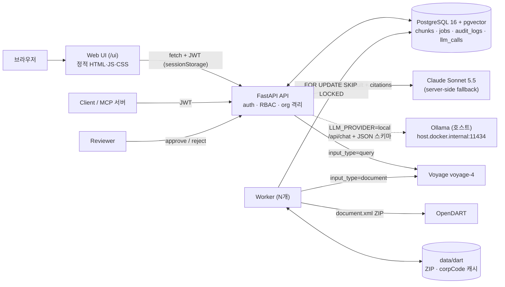
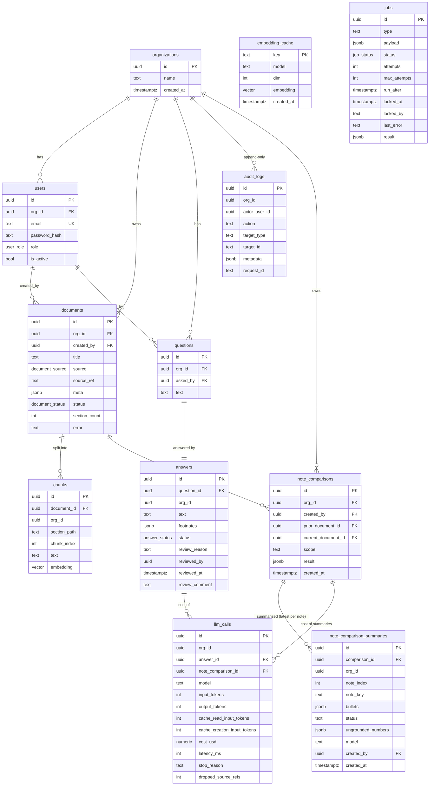
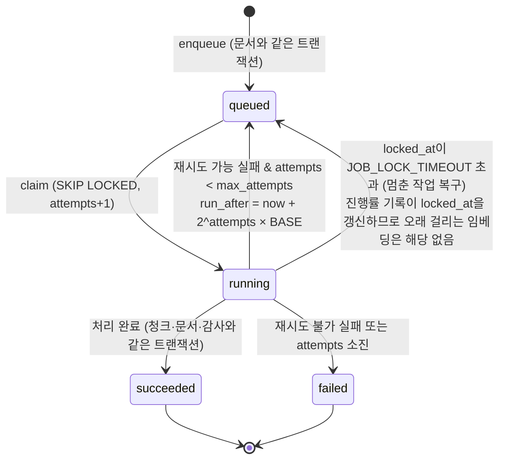

# 아키텍처

> 이 문서의 그림을 코드 위치와 함께 단계별로 해설한 학습 자료는 [docs/study/README.md](study/README.md)에 있습니다.

## 구성도



- **Web UI**는 FastAPI가 `/ui`에서 직접 서빙하는 빌드 없는 정적 파일(`src/footnote_rag/web/static/`)입니다. 브라우저에서 같은 출처의 HTTP API를 Bearer 토큰으로 호출하므로 권한 검사·조직 격리는 API와 같습니다. `/ui` 응답에만 CSP(`script-src 'self'` 등)·`nosniff`·`Referrer-Policy` 헤더를 붙입니다. 종목코드 검색은 CLI `dart-find`와 같은 서비스 함수(`dart/service.py::find_reports`)를 쓰는 `GET /dart/reports`가 제공합니다.
- **API**는 요청마다 `X-Request-ID`를 붙이고(없으면 생성) 처리 시간을 JSON 로그로 남깁니다. 감사 로그 행에도 같은 request_id가 저장됩니다.
- **워커**는 API와 같은 이미지에서 `python -m footnote_rag.jobs.worker`로 돌며 여러 개를 띄워도 됩니다.
- 외부 의존성(OpenDART, Voyage, Claude)은 모두 Protocol 뒤에 있고 `providers.py`가 실제/Fake 구현을 고릅니다. 테스트와 CI는 항상 Fake입니다.
- **Ollama(호스트, 선택)**: `LLM_PROVIDER=local`이면 Claude 대신 호스트에서 도는 Ollama로 답변을 만듭니다. Citations API가 없으므로 번호 붙은 근거와 JSON 스키마 강제 출력으로 문장별 근거 번호를 받고, 서버가 검증한 뒤 같은 각주 흐름에 태웁니다(점선, [ADR 0008](adr/0008-local-llm-ollama.md)). 워커는 LLM을 호출하지 않으므로 compose의 `extra_hosts`는 api 서비스에만 있습니다. 상태는 `GET /llm/status`(admin)로 확인합니다.

## ERD



- `documents`: `UNIQUE(org_id, source, source_ref)` — 같은 조직의 같은 접수번호는 하나만 존재합니다.
- `chunks.embedding`: `vector(EMBEDDING_DIM)`, HNSW(`vector_cosine_ops`) 인덱스와 `(org_id)` 인덱스.
- `embedding_cache`: 문서 임베딩 캐시. `key = sha256(model | dim | input_type | text)`이며 텍스트와 조직 ID는 저장하지 않습니다. 조직 간 공유 판단은 [ADR 0007](adr/0007-embedding-rate-limit-and-cache.md)을 보세요.
- `jobs`: 조직 컬럼 대신 `payload.org_id`를 두고 `GET /jobs/{id}`가 이 값으로 범위를 제한합니다. 실행 중에는 `result.progress = {stage, done, total}`(진행률)만 담기고, claim할 때 비워집니다. 성공하면 수집 결과(청크 수, `embedding_tokens`(실제 청구 대상), `embedding_cache_hits`, `embedding_cache_misses`, 마지막 `progress`)로 바뀝니다.
- `audit_logs`: `BEFORE UPDATE OR DELETE` 행 트리거와 `BEFORE TRUNCATE` 문장 트리거가 예외를 던집니다. 실패한 로그인처럼 조직을 알 수 없는 행은 `org_id`가 NULL입니다.
- `note_comparisons`: 전년·당년 사업보고서의 주석 비교 결과(`comparison.notes.compare_documents`의 JSON, 숫자는 문자열). `note_comparison_summaries`: 주석 하나의 로컬 모델 요약(`status` = `ok` | `needs_review`, `comparison_id`는 `ON DELETE CASCADE`). 다시 생성하면 행을 추가하고 조회는 주석별 최신 행을 씁니다. 요약 호출의 `llm_calls` 행은 `answer_id`가 NULL이고 `note_comparison_id`가 채워집니다([ADR 0012](adr/0012-note-change-analysis.md)).

## 조직 격리

모든 조회·변경은 현재 사용자의 `org_id`로 범위를 제한합니다(애플리케이션 계층). 다른 조직의 리소스 ID로 조회하면 존재 여부를 드러내지 않도록 `404`를 돌려줍니다. 벡터 검색은 `chunks.org_id`와 `documents.org_id`를 모두 조건에 넣고 `status='ready'` 문서만 대상으로 합니다. 테넌트 필터가 있는 HNSW 검색에서 결과가 `top_k`보다 적게 나오지 않도록 `SET LOCAL hnsw.iterative_scan = strict_order`(pgvector 0.8+)를 씁니다.

## 가져오기 흐름

```mermaid
sequenceDiagram
    autonumber
    participant C as Client
    participant A as API
    participant DB as Postgres
    participant W as Worker
    participant D as OpenDART
    participant V as Voyage
    C->>A: POST /documents/dart {rcept_no}
    A->>DB: BEGIN; INSERT documents(queued), jobs(import_dart), audit_logs; COMMIT
    A-->>C: 202 {document_id, job_id}
    W->>DB: SELECT … FOR UPDATE SKIP LOCKED → running, attempts+1
    W->>DB: progress = download (짧은 트랜잭션, 이후 단계마다 동일)
    W->>D: document.xml (data/dart/{rcept_no}.zip 캐시 우선)
    W->>W: XML 파싱 → section_path별 섹션 → 청킹(1,500자/200자 겹침)
    W->>DB: SELECT embedding_cache WHERE key IN (청크 키들) — 일괄 조회
    loop 캐시에 없는 텍스트만, 1,000개·토큰 한도(min(EMBED_BATCH_MAX_TOKENS, EMBED_TPM_LIMIT))로 배치
        W->>W: RateLimiter.acquire (60초 윈도우, EMBED_RPM_LIMIT·EMBED_TPM_LIMIT)
        W->>V: embed(input_type=document)
        alt 429 또는 일시 오류
            W->>W: 같은 배치만 min(BASE × 2^n, MAX) + 지터 대기 후 재시도(최대 EMBED_BATCH_MAX_RETRIES)
        else 성공
            W->>DB: INSERT embedding_cache … ON CONFLICT DO NOTHING; COMMIT
            W->>DB: progress = embed done/total (2초 이상 간격, locked_at 갱신)
        end
    end
    W->>DB: BEGIN; DELETE chunks; INSERT chunks; documents ready; jobs succeeded(result); audit; COMMIT
```

재시도 시 기존 청크를 지우고 다시 넣으므로 청크가 중복되지 않습니다. 배치 재시도를 다 써서 작업이 실패해도 이미 성공한 배치는 `embedding_cache`에 커밋되어 있으므로, 작업 단위 재시도나 재처리(`POST /documents/{id}/reprocess`)는 남은 청크만 Voyage로 보냅니다. 문서 응답(`GET /documents`, `GET /documents/{id}`)에는 최신 작업의 `progress`와, 재시도 대기 중이면 `next_retry_at`(그 작업의 `run_after`)이 붙습니다.

`RateLimiter`는 워커 프로세스 하나 안에서만 유효합니다. 워커를 여러 개 띄우면 한도를 워커 수로 나눠 설정해야 합니다(예: 3 RPM 계정에 워커 2개 → `EMBED_RPM_LIMIT=1`).

## 질문 처리 시퀀스

```mermaid
sequenceDiagram
    autonumber
    participant C as Client
    participant A as API
    participant V as Voyage
    participant DB as Postgres
    participant L as Claude
    C->>A: POST /questions {question, document_ids?}
    A->>DB: document_ids가 같은 조직 문서인지 확인 (아니면 404)
    A->>V: embed(question, input_type=query)
    A->>DB: pgvector cosine top_k (같은 org, ready 문서)
    alt 검색 결과 0건
        A->>A: "근거 없음" 답변, Claude 호출 안 함
    else
        A->>L: beta.messages.create(search_result 블록 × k + 질문, citations on,<br/>adaptive thinking, effort, fallbacks="default")
        L-->>A: stop_reason, content(text + citations)
        A->>A: refusal이면 content를 읽지 않음 / 아니면 citations → 각주 [n]
    end
    A->>A: 신뢰도 규칙 → published | pending_review(review_reason)
    A->>DB: BEGIN; questions, answers, llm_calls(실제 model·토큰·비용·지연), audit ×2; COMMIT
    A-->>C: {answer_id, status, text, footnotes, usage, latency_ms}
```

`LLM_PROVIDER=local`이면 위 그림의 Claude 호출·응답 단계가 Ollama `POST /api/chat`(`stream:false`, `format`=JSON 스키마, `options.num_ctx`)로 바뀝니다. 응답 JSON을 검증해(실패 시 1회 재요청, 범위 밖 근거 번호 제거) Claude와 같은 모양의 citations로 바꾼 뒤 같은 각주 변환을 탑니다. 각주의 `citation_method`는 Claude가 `api_citation`, 로컬이 `model_reference`입니다.

신뢰도 규칙(`REVIEW_MODE=on_low_confidence`): `refusal`, `no_retrieval_results`, `low_retrieval_score`(최고 유사도 < `MIN_RETRIEVAL_SCORE`), `no_citations`, `truncated`(로컬 모델이 출력 상한에 걸림) 중 하나라도 해당하면 `pending_review`입니다. `REVIEW_MODE=always`면 모든 답변이 검토 대기로 갑니다. member는 `pending_review` 답변의 본문을 볼 수 없습니다.

## 작업 상태 전이



| 실패 | 분류 |
| --- | --- |
| OpenDART 020(요청 한도), 800(점검), 900, HTTP 5xx/429, 네트워크 오류 | 재시도 |
| OpenDART 010/011/012/901(키·권한), 013(데이터 없음), 014(파일 없음), HTTP 4xx | 즉시 실패 |
| 파싱 실패(텍스트 없음, ZIP 아님) | 즉시 실패 |
| Voyage 429(`RateLimitError`)·5xx·연결·타임아웃·`TryAgain` | 먼저 **같은 배치만** 재시도(최대 `EMBED_BATCH_MAX_RETRIES`회, 지수 백오프 + 지터). 다 쓰면 작업 단위 재시도 |
| Voyage 그 밖의 오류(인증, 잘못된 요청 등) | 즉시 실패(배치 재시도 없음) |

작업이 실패하면 `jobs.last_error`와 `documents.error`가 채워지고 문서는 `failed`(재시도 예정이면 `queued`)가 됩니다. 임베딩 실패는 한국어 설명이 남습니다(예: `임베딩 제공자 요청 한도 초과(결제 수단 미등록 가능성): 배치 재시도 6회 소진 — …`). 429 메시지에 "payment method"가 있으면 워커가 프로세스당 한 번 `embedding.provider_reduced_limits` 경고를 남깁니다(키·원문은 남기지 않음). 워커는 SIGTERM을 받으면 처리 중인 작업을 끝낸 뒤 종료합니다.

## 동시성 보장

| 상황 | 방법 |
| --- | --- |
| 워커 여러 개가 같은 작업 claim | `FOR UPDATE SKIP LOCKED` + 같은 트랜잭션에서 `running`으로 변경 |
| 같은 접수번호 동시 가져오기 | `UNIQUE(org_id, source, source_ref)` → IntegrityError 시 기존 문서 반환 |
| 두 검토자가 동시에 결정 | `UPDATE … WHERE status='pending_review' RETURNING` 한 번 — 패자는 0행 → 409 |
| 감사 로그 변조 | DB 트리거가 UPDATE/DELETE/TRUNCATE 거부 |
