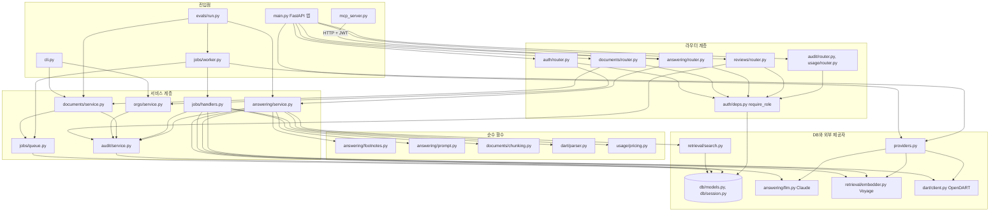

# 01. 전체 그림: 무엇을 풀고, 어떻게 나뉘어 있나

> 예상 소요: 30분 · 다음 문서: [02. 요청 두 개 따라가기](02-request-walkthrough.md)

## 이 문서에서 배울 것

- 이 서비스가 푸는 문제와, 답에 **각주**를 다는 이유를 설명할 수 있다.
- 두 프로세스(API, 워커)와 데이터베이스·외부 제공자 셋의 관계를 그릴 수 있다.
- `src/footnote_rag/` 패키지가 어떤 계층으로 나뉘는지 알고, 질문이 들어왔을 때 어느 파일부터 열어야 하는지 안다.
- 현재 저장소의 한계(실제 DART 데이터 미수집 등)를 정확히 말할 수 있다.

## 개념

### 해결하려는 문제

감사보고서(회계법인이 회사 재무제표를 감사한 뒤 내는 보고서)의 **주석**에는 리스, 우발부채, 회계정책 같은 서술형 정보가 많다. 사람이 "이 회사는 리스부채를 어떻게 측정하나요?"라고 물으면 답과 함께 **어느 보고서의 어느 목차에서 나온 말인지**를 보여 줘야 감사·회계 실무에서 쓸 수 있다. 모델이 그럴듯한 출처를 지어내면 치명적이다.

그래서 이 서비스는 다음을 한다.

1. OpenDART에서 감사보고서(상장사는 감사받은 재무제표·주석이 들어 있는 사업보고서 A001) 원문을 접수번호([rcept_no](glossary.md#rcept_no))로 가져와 목차 경로([section_path](glossary.md#section_path))별로 나누고 벡터로 저장한다.
2. 질문이 오면 관련 조각([청크](glossary.md#청킹))을 찾아 Claude에게 근거로 주고, Claude의 [Citations](glossary.md#citations) 기능이 돌려주는 인용 위치를 문장별 각주 `[1]`, `[2]`로 바꾼다.
3. 근거가 약하면 바로 공개하지 않고 사람 검토([HITL](glossary.md#hitl)) 대기열로 보낸다.

이런 구조를 [RAG](glossary.md#rag)(Retrieval-Augmented Generation, 검색 증강 생성)라고 한다. 모델이 기억에 의존하지 않고, 검색해 온 문서를 근거로 답하게 만드는 방식이다.

### 두 프로세스와 저장소 하나

| 구성 요소 | 실행 명령 | 하는 일 |
| --- | --- | --- |
| API | `uvicorn footnote_rag.main:app` | 로그인, 가져오기 요청 접수, 질문 답변, 검토, 감사 로그·사용량 조회 |
| 워커 | `python -m footnote_rag.jobs.worker` | 작업 큐에서 가져오기 작업을 꺼내 다운로드·파싱·청킹·임베딩·저장 |
| PostgreSQL 16 + pgvector | Docker Compose `db` | 업무 데이터, 작업 큐, 벡터 인덱스, 감사 로그를 모두 한곳에 저장 |

외부 제공자는 셋이다. OpenDART(공시 원문), Voyage(임베딩), Claude(답변 생성). 셋 모두 Protocol 뒤에 숨어 있어 키가 없으면 Fake 구현으로 바뀐다([09. 테스트와 운영](09-testing-and-ops.md)).

전체 구성도와 ERD는 [docs/architecture.md](../architecture.md)에 있다. 이 문서는 그 그림을 **코드 패키지 기준**으로 다시 본다.

## 이 저장소의 구현

### 모듈 지도

| 패키지 / 모듈 | 계층 | 역할 | 먼저 볼 함수 |
| --- | --- | --- | --- |
| `src/footnote_rag/main.py` | 진입점 | 라우터 조립, request_id 미들웨어, `/healthz`·`/readyz` | `src/footnote_rag/main.py::create_app` |
| `src/footnote_rag/auth/` | 라우터 + 의존성 | 로그인, JWT, 역할 검사 | `src/footnote_rag/auth/deps.py::require_role` |
| `src/footnote_rag/documents/` | 라우터 + 서비스 + 순수 함수 | 가져오기 요청, 업로드, 청킹 | `src/footnote_rag/documents/service.py::request_dart_import` |
| `src/footnote_rag/jobs/` | 서비스 + 워커 | 작업 큐, 핸들러, 폴링 워커 | `src/footnote_rag/jobs/queue.py::claim_job` |
| `src/footnote_rag/dart/` | 외부 연동 + 순수 함수 | OpenDART 클라이언트, XML 파서, 합성 데이터 | `src/footnote_rag/dart/parser.py::parse_document_zip` |
| `src/footnote_rag/retrieval/` | 외부 연동 + DB | 임베딩, pgvector 검색 | `src/footnote_rag/retrieval/search.py::search_chunks` |
| `src/footnote_rag/answering/` | 라우터 + 서비스 + 순수 함수 | 질문 처리, Claude 호출, 각주 변환 | `src/footnote_rag/answering/service.py::ask_question` |
| `src/footnote_rag/reviews/` | 라우터 | 사람 검토 결정 | `src/footnote_rag/reviews/router.py::decide` |
| `src/footnote_rag/audit/` | 서비스 + 라우터 | 감사 로그 기록·조회 | `src/footnote_rag/audit/service.py::record` |
| `src/footnote_rag/usage/` | 순수 함수 + 라우터 | 비용 계산, 사용량 집계 | `src/footnote_rag/usage/pricing.py::compute_cost` |
| `src/footnote_rag/orgs/` | 서비스 | 조직·사용자 생성 | `src/footnote_rag/orgs/service.py::seed_org` |
| `src/footnote_rag/db/` | DB | ORM 모델, 세션 | `src/footnote_rag/db/session.py::get_session` |
| `src/footnote_rag/providers.py` | 조립 | 실제/Fake 제공자 선택 | `src/footnote_rag/providers.py::make_llm` |
| `src/footnote_rag/evals/` | 도구 | Eval 실행기·검증기 | `src/footnote_rag/evals/run.py::run_eval` |
| `src/footnote_rag/mcp_server.py` | 도구 | MCP 서버(HTTP API 호출) | `src/footnote_rag/mcp_server.py::ask` |
| `src/footnote_rag/cli.py` | 도구 | seed, dart-find, dart-fetch, dart-import | `src/footnote_rag/cli.py::cmd_dart_fetch` |

스키마(테이블·인덱스·트리거)는 ORM이 아니라 Alembic 마이그레이션 `alembic/versions/0001_initial.py`가 만든다. `src/footnote_rag/db/models.py`는 그 테이블을 파이썬에서 다루기 위한 매핑이다.

### 계층 규칙

코드를 읽을 때 다음 규칙을 기억하면 길을 잃지 않는다.

1. **라우터**(`*/router.py`)는 요청 검증, 권한 의존성(`require_role`), 예외 → HTTP 상태 변환만 한다.
2. **서비스**(`*/service.py`, `jobs/handlers.py`)가 업무 규칙과 **트랜잭션 경계**(언제 커밋하는가)를 가진다.
3. **순수 함수**(`answering/footnotes.py`, `answering/prompt.py`, `documents/chunking.py`, `dart/parser.py`, `usage/pricing.py`)는 DB나 네트워크를 만지지 않는다. 그래서 단위 테스트가 쉽다.
4. **외부 제공자**(`answering/llm.py`, `retrieval/embedder.py`, `dart/client.py`)는 Protocol을 구현하고, `providers.py`가 실제/Fake를 고른다.

## 설계도: 패키지 의존 관계

위에서 아래로 갈수록 "요청에서 멀고 데이터·외부 시스템에 가까운" 계층이다. 화살표는 "import해서 호출한다"는 뜻이며 거꾸로 올라가는 화살표는 없다(예외: `evals/run.py`는 도구라서 워커를 직접 돌린다).
순수 함수 계층은 DB도 네트워크도 모르기 때문에 `tests/test_footnotes.py`, `tests/test_dart_parser.py`처럼 DB 없이 검증된다.
MCP 서버는 서비스 계층을 import하지 않고 HTTP로만 들어온다는 점이 중요하다([10. Eval과 MCP](10-eval-and-mcp.md)).

### 실행 단위로 보면

- API 프로세스는 `src/footnote_rag/main.py::lifespan`에서 임베더와 LLM을 한 번 만들어 `app.state`에 둔다. 라우터는 `src/footnote_rag/answering/router.py::get_llm`으로 꺼내 쓴다. 테스트는 이 자리에 Fake를 끼운다.
- 워커 프로세스는 `src/footnote_rag/jobs/worker.py::_main`에서 임베더와 DART 클라이언트를 만들어 `JobContext`로 핸들러에 넘긴다. 워커는 Claude를 쓰지 않는다.
- 두 프로세스는 **DB로만** 대화한다. API가 `jobs` 행을 넣고, 워커가 그 행을 꺼낸다([04. 작업 큐](04-job-queue.md)).

## 왜 이렇게 했나 / 대안 / 한계와 개선 방향

**왜**
- 큐·벡터·업무 데이터를 Postgres 하나에 둔 것은 문서 생성과 작업 등록을 한 트랜잭션으로 묶기 위해서다([ADR 0001](../adr/0001-postgres-skip-locked-queue.md)).
- 각주 근거를 프롬프트로 만들지 않고 API의 Citations 기능에 맡긴 것은 인용문 조작 가능성을 줄이기 위해서다([ADR 0002](../adr/0002-claude-citations-search-result.md)).
- 원문을 PDF가 아닌 OpenDART XML로 받고 위치를 페이지 대신 목차 경로로 표시한다([ADR 0004](../adr/0004-opendart-xml-over-pdf.md)).

**대안**
- 전용 벡터 데이터베이스를 따로 두는 구성도 가능하다. 이 저장소는 조직 필터와 문서 상태(`ready`) 조건을 벡터 검색과 **같은 SQL 한 문장**으로 건다. 저장소를 나누면 이 조건과 문서 상태를 두 저장소 사이에서 맞춰야 한다([05. RAG 검색](05-rag-retrieval.md)).
- LangChain 같은 RAG 프레임워크를 쓰지 않고 직접 구현했다. 단계마다 무엇을 하는지 코드로 바로 보이는 대신, 프레임워크가 주는 부가 기능은 없다.

**한계 (사실 그대로)**
- **실제 DART 데이터를 아직 받지 못했다.** 작업 환경에서 `OPENDART_API_KEY`가 인식되지 않았다([docs/data-sources.md](../data-sources.md)).
- 그래서 **DART XML 파서 구조는 가정**이며 합성 픽스처(`tests/fixtures/synthetic_audit_report.xml`, `src/footnote_rag/dart/fake_data.py`)로만 검증했다([07. OpenDART 연동](07-dart-integration.md)).
- **Eval 실측은 로컬 모델 한 번뿐이다**(`evals/dataset.jsonl` 25문항, `ollama:qwen3:14b`). Claude 결과는 아직 없다([10. Eval과 MCP](10-eval-and-mcp.md)).
- 성능(지연시간, 처리량)을 측정한 기록이 없다. 면접에서 숫자를 묻는다면 "측정하지 않았다"가 정확한 답이다.

## 확인 질문

1. API 프로세스와 워커 프로세스는 무엇을 통해 협력하나?
   

답

   PostgreSQL의 `jobs` 테이블을 통해서만 협력한다. API는 `src/footnote_rag/jobs/queue.py::enqueue`로 작업 행을 같은 트랜잭션에 추가하고, 워커는 `src/footnote_rag/jobs/queue.py::claim_job`으로 꺼낸다. 메시지 브로커는 없다.
   

2. 각주 번호를 매기는 코드는 왜 DB 없이 테스트할 수 있나?
   

답

   `src/footnote_rag/answering/footnotes.py::build_footnotes`가 입력(응답 블록 목록, 검색 청크 메타데이터)만 받아 결과를 돌려주는 순수 함수이기 때문이다. `tests/test_footnotes.py`가 dict만으로 검증한다.
   

3. MCP 서버가 서비스 계층을 직접 import하지 않는 이유는?
   

답

   HTTP API를 사용자 토큰으로 호출해야 `require_role`과 조직 격리가 그대로 적용되기 때문이다. DB에 직접 붙으면 권한 검사를 다시 구현해야 한다.
   

4. 이 저장소의 검색·답변 품질을 수치로 말할 수 있나?
   

답

   일부만 말할 수 있다. 실제 사업보고서 3건으로 만든 25문항을 로컬 모델(`ollama:qwen3:14b`)로 한 번 돌린 결과가 있다(recall@8 95.2%, 인용 정확도 61.3%, 답할 수 없는 질문 거절 100%, 평균 11,639ms). Claude로는 아직 측정하지 않았다. 수치와 리포트 링크는 [README "Eval 결과 (실측)"](../../README.md#eval-결과-실측)에 있다.
   

