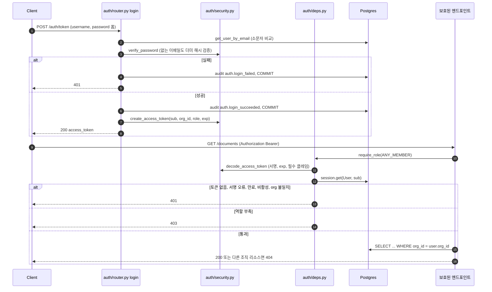

# 03. 인증·인가·조직 격리

> 예상 소요: 40분 · 이전: [02. 요청 따라가기](02-request-walkthrough.md) · 다음: [04. 작업 큐](04-job-queue.md)

## 이 문서에서 배울 것

- OAuth2 password flow로 토큰을 받고, 그 토큰으로 보호된 API를 부르는 과정을 순서대로 설명할 수 있다.
- 이 저장소의 JWT에 들어 있는 클레임과, 서버가 토큰을 **믿지 않고** DB를 다시 읽는 이유를 안다.
- 401, 403, 404가 각각 언제 나가는지 구분할 수 있다.
- 조직 격리를 애플리케이션 계층에서 하는 방식과 Postgres RLS의 차이를 말할 수 있다.

## 개념

- **인증(authentication)**: "누구인가"를 확인한다. 실패하면 401.
- **인가(authorization)**: "그 일을 해도 되는가"를 확인한다. 실패하면 403.
- **OAuth2 password flow**: 클라이언트가 사용자 이메일·비밀번호를 폼(`username`, `password`)으로 토큰 엔드포인트에 보내 액세스 토큰을 받는 방식. FastAPI의 `OAuth2PasswordRequestForm`과 `OAuth2PasswordBearer`가 이 형식을 다룬다. 외부 IdP를 통한 SSO(OIDC)와는 다르다.
- **[JWT](glossary.md#jwt)**: 서명된 JSON 토큰. 서버는 비밀키로 서명을 검증해 위조 여부를 안다. 내용은 암호화되지 않으므로 비밀을 넣지 않는다.
- **[RBAC](glossary.md#rbac)**: 역할 기반 접근 제어. 이 저장소의 역할은 `admin`, `reviewer`, `member` 셋이다.
- **argon2**: 비밀번호 해시 알고리즘. 일부러 느리고 메모리를 많이 써서 무차별 대입을 어렵게 한다. 이 저장소는 `pwdlib`의 `PasswordHash.recommended()`를 쓴다.
- **[테넌트 격리](glossary.md#테넌트-격리)**: 여러 조직(테넌트)이 한 DB를 쓰되 서로의 데이터를 볼 수 없게 하는 것.

## 이 저장소의 구현

### 1단계: 로그인 → 토큰

출처: `src/footnote_rag/auth/router.py::login`

```python
    user = await get_user_by_email(session, form.username)
    ok = verify_password(form.password, user.password_hash if user else None)
    if not ok or user is None or not user.is_active:
        record(
            session,
            action=Actions.LOGIN_FAILED,
            org_id=user.org_id if user else None,
            ...
            metadata={"email": form.username.lower()[:320]},
        )
        await session.commit()
        raise HTTPException(status_code=status.HTTP_401_UNAUTHORIZED, ...)
```

- 이메일 조회는 소문자 비교다(`src/footnote_rag/orgs/service.py::get_user_by_email`).
- 없는 이메일이어도 `src/footnote_rag/auth/security.py::verify_password`가 **더미 해시를 검증**한다. 응답 시간 차이로 "이 이메일은 가입되어 있다"는 사실이 새지 않게 하려는 것이다.
- 실패한 로그인도 감사 로그에 남는다. 조직을 모르면 `org_id`가 NULL이다(`tests/test_auth.py::test_wrong_password_is_401_and_audited`).

### 2단계: 토큰의 내용

출처: `src/footnote_rag/auth/security.py::create_access_token`

```python
    payload = {
        "sub": str(user_id),
        "org_id": str(org_id),
        "role": role,
        "iat": int(now.timestamp()),
        "exp": int((now + timedelta(minutes=s.access_token_expire_minutes)).timestamp()),
    }
    return jwt.encode(payload, s.jwt_secret.get_secret_value(), algorithm=s.jwt_algorithm)
```

- 알고리즘은 `JWT_ALGORITHM` 기본 `HS256`(대칭키), 만료는 `ACCESS_TOKEN_EXPIRE_MINUTES` 기본 60분.
- `src/footnote_rag/auth/security.py::decode_access_token`은 `sub`, `org_id`, `role`, `exp`가 **반드시 있어야** 통과시킨다(`options={"require": [...]}`).
- `APP_ENV=production`인데 `JWT_SECRET`이 개발용 기본값이면 앱이 기동을 거부한다(`src/footnote_rag/main.py::lifespan`).

### 3단계: 보호된 요청

출처: `src/footnote_rag/auth/deps.py::get_current_user`, `src/footnote_rag/auth/deps.py::require_role`

```python
    try:
        claims = decode_access_token(token)
    except (jwt.PyJWTError, ValueError, KeyError):
        raise _UNAUTHORIZED from None
    user = await session.get(User, claims.user_id)
    if user is None or not user.is_active or user.org_id != claims.org_id:
        raise _UNAUTHORIZED
    return user


def require_role(*roles: str) -> Callable[..., Awaitable[User]]:
    allowed = frozenset(roles)

    async def _checker(user: User = Depends(get_current_user)) -> User:
        if user.role not in allowed:
            raise HTTPException(status_code=status.HTTP_403_FORBIDDEN, detail="Forbidden")
        return user
```

읽는 포인트:
- 서명이 맞아도 **DB에서 사용자를 다시 읽는다.** 비활성화된 사용자는 토큰이 만료되기 전이라도 즉시 401이 된다.
- 토큰의 `org_id`와 DB의 `org_id`가 다르면 401이다(`tests/test_auth.py::test_token_with_mismatched_org_is_401`).
- 역할 검사는 토큰의 `role` 클레임이 아니라 **DB에서 읽은 `user.role`** 로 한다. 역할을 바꾸면 다음 요청부터 바로 반영된다.
- `require_role`은 "역할 목록을 받아 의존성 함수를 만들어 주는" 팩토리다. 라우터는 `Depends(require_role(*REVIEWERS))`처럼 쓴다. 묶음은 `ANY_MEMBER`, `REVIEWERS`, `ADMINS` 세 개다.

### 설계도: 로그인 → 토큰 → 보호된 요청



로그인 단계는 성공·실패 모두 감사 로그를 커밋한 뒤 응답한다. 보호된 요청은 `require_role`이 `get_current_user`에 의존하므로, 401 검사(토큰과 사용자 상태)가 403 검사(역할)보다 먼저 일어난다.
권한을 통과한 뒤에도 모든 조회에 `org_id` 조건이 붙는다. 그래서 다른 조직의 ID를 넣으면 "없음"(404)이 된다.

### 조직 격리: 모든 쿼리에 `org_id`

| 엔드포인트 | 조건 | 코드 |
| --- | --- | --- |
| `GET /documents/{id}` | `Document.id == id AND Document.org_id == user.org_id` | `src/footnote_rag/documents/router.py::get_document` |
| `GET /jobs/{id}` | `jobs`에는 조직 컬럼이 없어 `payload["org_id"]`로 비교 | `src/footnote_rag/documents/router.py::get_job` |
| `GET /answers/{id}` | `Answer.org_id == user.org_id` + member 가시성 | `src/footnote_rag/answering/router.py::get_answer` |
| `POST /reviews/{id}` | 조건부 UPDATE에 `Answer.org_id == org_id` | `src/footnote_rag/reviews/router.py::decide` |
| `POST /questions`, `/search` | `chunks.org_id`와 `documents.org_id` 모두 | `src/footnote_rag/retrieval/search.py::search_chunks` |
| `GET /audit-logs`, `/usage` | `org_id == user.org_id` | `src/footnote_rag/audit/router.py::list_audit_logs`, `src/footnote_rag/usage/router.py::get_usage` |

**"다른 조직은 404"인 이유**: 403("있지만 권한 없음")을 돌려주면 공격자가 ID를 바꿔 가며 어떤 리소스가 존재하는지 알아낼 수 있다. 404는 존재 여부 자체를 숨긴다. 테스트: `tests/test_auth.py::test_other_org_resources_are_404`.

`POST /users`로 만든 사용자는 항상 **관리자와 같은 조직**에 들어간다(`src/footnote_rag/auth/router.py::create_user_endpoint`가 `org_id=admin.org_id`를 넘김). 다만 `users.email`은 **전체 DB에서 UNIQUE**라 다른 조직이 같은 이메일을 쓸 수 없다.

## 왜 이렇게 했나 / 대안 / 한계와 개선 방향

**왜 앱 계층 격리인가** ([ADR 0005](../adr/0005-org-isolation-app-layer.md))
- 쿼리마다 `org_id` 조건을 넣고, 교차 조직 접근이 404인지 테스트로 확인한다.
- Postgres RLS(Row-Level Security)는 쿼리를 빠뜨려도 DB가 막아 주는 두 번째 방어선이지만, 요청마다 `SET LOCAL app.org_id`를 걸어야 하고 워커처럼 여러 조직을 처리하는 경로에는 별도 역할이 필요하며, 커넥션 풀과 함께 쓸 때 설정 누수를 조심해야 한다. ADR은 이를 후속 과제로 둔다.

**대안**
- 토큰만 믿고 DB를 읽지 않는 방식: 요청당 쿼리 하나를 아끼지만, 비활성화·역할 변경이 토큰 만료 전까지 반영되지 않는다.
- 조직별 스키마나 조직별 DB: 격리는 강하지만 마이그레이션·운영 비용이 크다.
- 외부 IdP(OIDC) SSO: 이 저장소에는 **없다**.

**한계와 개선 방향**
- 리프레시 토큰, 로그아웃(토큰 폐기 목록)이 없다. 토큰은 만료까지 유효하다. 다만 사용자를 비활성화하면 DB 재조회 덕분에 바로 막힌다.
- 로그인 시도 횟수 제한(rate limit)이나 계정 잠금이 없다.
- HS256 대칭키라 토큰을 검증하는 모든 서비스가 같은 비밀키를 가져야 한다. 서비스가 늘면 RS256 같은 비대칭키가 낫다.
- RLS가 없으므로, 새 쿼리를 추가할 때 `org_id` 조건을 빠뜨리면 격리가 깨진다. 이를 막는 것은 지금은 리뷰와 테스트뿐이다.

## 확인 질문

1. 같은 토큰으로 요청했는데 어제는 200이었고 오늘은 401이다. 가능한 원인은?
   <details><summary>답</summary>

   토큰 만료(`exp`), 사용자 비활성화(`is_active=false`), 사용자의 조직 변경(토큰 `org_id`와 DB 불일치), 사용자 삭제, `JWT_SECRET` 변경(서명 검증 실패)이 있다. `src/footnote_rag/auth/deps.py::get_current_user`의 조건을 보면 된다.
   </details>

2. member가 `GET /audit-logs`를 부르면 몇 번이 나오나? 다른 조직의 답변 ID로 `GET /answers/{id}`를 부르면?
   <details><summary>답</summary>

   앞은 403(인증은 됐지만 `ADMINS` 역할이 아님), 뒤는 404(조건에 `org_id`가 있어 행이 안 보임)다. `tests/test_auth.py::test_role_checks_are_403`, `tests/test_auth.py::test_other_org_resources_are_404`.
   </details>

3. 관리자가 어떤 사용자의 역할을 member로 내렸다. 그 사용자가 가진 토큰(역할 클레임은 reviewer)으로 검토를 시도하면?
   <details><summary>답</summary>

   403이다. `require_role`은 토큰의 `role` 클레임이 아니라 DB에서 읽은 `user.role`을 검사한다.
   </details>

4. 없는 이메일로 로그인할 때도 해시 검증을 하는 이유는?
   <details><summary>답</summary>

   없는 이메일이면 바로 실패하고 있는 이메일이면 argon2 검증을 하느라 느려지면, 응답 시간으로 가입 여부가 드러난다. `_DUMMY_HASH`로 비슷한 시간을 쓰게 한다.
   </details>
