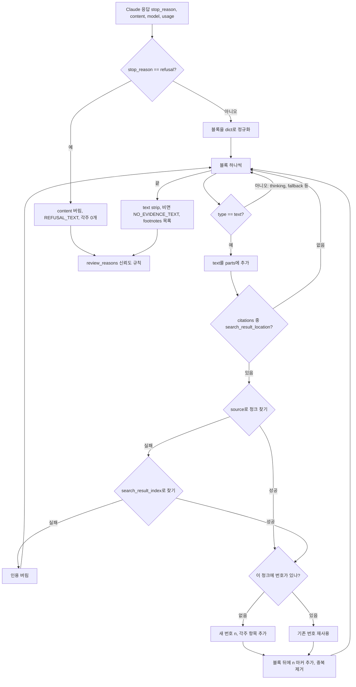

# 06. Claude Messages API, Citations, 각주 변환

> 예상 소요: 60분 · 이전: [05. RAG 검색](05-rag-retrieval.md) · 다음: [07. OpenDART 연동](07-dart-integration.md)

## 이 문서에서 배울 것

- Claude Messages API 요청·응답의 기본 구조(system, messages, content 블록, `stop_reason`, `usage`)를 안다.
- `search_result` 블록과 Citations가 각주의 근거를 어떻게 보장하는지 설명할 수 있다.
- `src/footnote_rag/answering/footnotes.py`의 각주 번호 매기기 규칙을 예시로 직접 계산할 수 있다.
- adaptive thinking, `effort`, 서버 측 `fallbacks`, `stop_reason == "refusal"` 처리를 설명하고, 보내지 않는 파라미터와 그 이유를 말할 수 있다.

## 개념

### Messages API 기본

요청은 `model`, `max_tokens`, `system`(시스템 프롬프트), `messages`(대화 목록)로 이루어진다. 메시지의 `content`는 **블록 목록**이다. 이 저장소는 user 메시지 하나에 `search_result` 블록 여러 개와 질문 text 블록 하나를 넣는다.

응답의 `content`도 블록 목록이다. 이 저장소가 받을 수 있는 블록은 `thinking`(모델의 사고 블록), `text`(답변 텍스트, citations가 붙을 수 있음), 그리고 fallback이 일어났을 때의 `fallback` 블록 등이다. 그 밖에 `stop_reason`(왜 멈췄는지), `model`(실제로 답한 모델), `usage`(토큰 수)가 온다.

### `search_result` 블록과 [Citations](glossary.md#citations)

RAG에서 검색한 조각을 `search_result` 블록으로 보내고 `citations: {"enabled": true}`를 켜면, 모델이 근거로 쓴 문장 뒤의 text 블록에 **구조화된 인용 정보**가 붙어 돌아온다. 인용 타입은 `search_result_location`이고 필드는 `source`, `title`, `cited_text`, `search_result_index`, `start_block_index`, `end_block_index`다([ADR 0002](../adr/0002-claude-citations-search-result.md)에서 설치된 SDK로 확인).

중요한 성질: `cited_text`는 API가 **보낸 원문에서 잘라 주는 값**이다. 모델이 인용문을 바꿔 쓸 수 없다. 프롬프트로 "출처를 [1] 형식으로 달아라"라고 시키는 방식과 가장 큰 차이다.

### [adaptive thinking](glossary.md#adaptive-thinking)과 [effort](glossary.md#effort)

- `thinking: {"type": "adaptive"}`: 모델이 문제에 따라 **생각할지, 얼마나 생각할지 스스로 정한다.** 예전 방식처럼 사고 토큰 예산(`budget_tokens`)을 고정하지 않는다.
- `output_config: {"effort": ...}`: `low` ~ `max` 단계로 사고 깊이와 전체 토큰 사용량을 조절하는 손잡이다. 이 저장소는 `CLAUDE_EFFORT` 기본 `medium`을 **명시적으로** 보낸다.

### [refusal](glossary.md#refusal)과 서버 측 [fallback](glossary.md#fallback)

- 안전 분류기가 요청을 거절하면 HTTP 200에 `stop_reason: "refusal"`이 온다. 오류가 아니므로 예외 처리로는 잡히지 않는다. **content를 읽기 전에 `stop_reason`부터 확인**해야 한다.
- 서버 측 fallback: beta 헤더 `server-side-fallback-2026-07-01`과 `fallbacks="default"`를 보내면, 특정 범주의 거절은 API가 같은 호출 안에서 다른 모델로 다시 시도한다. ADR 0002에 따르면 Sonnet 5.5는 이 `"default"` 형식만 지원하고, 재시도하지 않는 범주도 있어 최종 응답이 여전히 `refusal`일 수 있다.

## 이 저장소의 구현

### 요청 만들기

출처: `src/footnote_rag/answering/prompt.py::build_messages`

```python
    blocks: list[dict[str, Any]] = [
        {
            "type": "search_result",
            "source": source_id(c.document_id, c.chunk_id),
            "title": f"{c.document_title} · {c.section_path}",
            "content": [{"type": "text", "text": c.text}],
            "citations": {"enabled": True},
        }
        for c in chunks
    ]
    blocks.append({"type": "text", "text": question})
    return [{"role": "user", "content": blocks}]
```

- `source`는 `doc:{document_id}#chunk:{chunk_id}` 형식이다(`src/footnote_rag/answering/prompt.py::source_id`). 응답 인용의 `source`로 어느 청크인지 다시 찾는 열쇠다.
- `title`에 목차 경로를 넣어 모델이 어느 부분인지 알 수 있게 한다.
- 모든 블록에 citations를 같게 켠다. ADR에 따르면 한 요청의 `search_result` 블록은 citations 설정이 같아야 한다.

출처: `src/footnote_rag/answering/llm.py::ClaudeClient.request_params`

```python
        return {
            "model": self.model,
            "max_tokens": self.max_tokens,
            "system": system,
            "messages": messages,
            "thinking": {"type": "adaptive"},
            "output_config": {"effort": self.effort},
            "betas": [FALLBACK_BETA],
            "fallbacks": "default",
        }
```

호출은 `client.beta.messages.create(**params)`(비스트리밍)이고, SDK 클라이언트는 `timeout=CLAUDE_TIMEOUT_SECONDS`(기본 120), `max_retries=2`로 만든다.

### 보내지 않는 파라미터와 이유

`tests/test_answering.py::test_claude_request_shape`가 요청 모양을 검사한다.

| 보내지 않는 것 | 이유 |
| --- | --- |
| `temperature`, `top_p`, `top_k` | Sonnet 5.5에서 기본값이 아닌 샘플링 값은 400 오류다 |
| `thinking.budget_tokens`, `thinking: {"type": "disabled"}` | 이 모델에서 고정 사고 예산과 사고 끄기는 400이다. 깊이는 `effort`로 조절한다 |
| assistant prefill(마지막 메시지를 assistant로 미리 채우기) | 이 모델에서 400이다. 테스트는 마지막 메시지가 user인지 확인한다 |
| 강제 `tool_choice` | 이 모델에서 `any`/`tool` 강제는 400이다. 이 저장소는 도구를 쓰지 않는다 |
| `output_config.format`(structured outputs) | citations와 함께 쓰면 400이다(ADR 0002) |
| `stream` | 비스트리밍 요청이다. 각주 변환은 응답 전체를 받은 뒤에 한다 |

### 응답 정규화와 거절 처리

출처: `src/footnote_rag/answering/llm.py::ClaudeClient.answer`

```python
        # Check stop_reason BEFORE reading content: a refusal carries no usable answer.
        if resp.stop_reason == "refusal":
            category = getattr(getattr(resp, "stop_details", None), "category", None)
            log.warning("llm.refusal", model=resp.model, category=category)
            return LLMResponse(resp.model, "refusal", [], usage, latency_ms)
        content = [block.model_dump(mode="json", exclude_none=True) for block in resp.content]
        return LLMResponse(resp.model, resp.stop_reason, content, usage, latency_ms)
```

- 거절이면 content를 버리고 빈 목록을 돌려준다. 서비스는 고정 문구(`REFUSAL_TEXT`)를 답으로 쓰고 `pending_review(refusal)`로 보낸다. 거절 범주(`stop_details.category`)는 로그에만 남긴다.
- 그 밖에는 SDK 객체를 **Messages API 모양의 dict**로 바꾼다. 그래서 각주 변환 함수는 SDK를 몰라도 되고 dict로 테스트할 수 있다.
- `usage`와 **응답의 실제 `model`** 을 저장한다. fallback이 일어나면 요청 모델과 다를 수 있기 때문이다(`tests/test_reviews_audit_usage.py::test_llm_call_records_actual_response_model`).
- SDK 예외 매핑: `RateLimitError` → 503, `APIStatusError` 5xx → 503, 그 밖 → 502, `APIConnectionError` → 503(`tests/test_answering.py::test_claude_errors_map_to_502_503`).

### 각주 번호 매기기 알고리즘

출처: `src/footnote_rag/answering/footnotes.py::build_footnotes`

```python
    for block in content:
        if block.get("type") != "text":
            continue
        parts.append(str(block.get("text", "")))
        markers: list[int] = []
        for citation in block.get("citations") or []:
            if citation.get("type") != "search_result_location":
                continue
            ref = by_source.get(str(citation.get("source", "")))
            if ref is None:
                idx = citation.get("search_result_index")
                if isinstance(idx, int) and 0 <= idx < len(sources):
                    ref = sources[idx]
            if ref is None:
                continue
            # 번호는 청크 기준: ...
            if ref.chunk_id not in numbers:
                n = len(numbers) + 1
                numbers[ref.chunk_id] = n
                footnotes.append({...})
            n = numbers[ref.chunk_id]
            if n not in markers:
                markers.append(n)
        if markers:
            parts.append("".join(f"[{n}]" for n in markers))
```

규칙:
1. text가 아닌 블록(`thinking`, `fallback`, `tool_use` 등)은 무시한다.
2. text 블록은 순서대로 이어 붙인다. Citations가 켜지면 응답이 인용 단위로 여러 text 블록으로 쪼개져 오므로, 블록 단위가 곧 문장(또는 구절) 단위가 된다.
3. 인용된 청크는 `source`로 찾고, 실패하면 `search_result_index`로 찾는다. 둘 다 안 되면 버린다.
4. **번호는 청크 기준 첫 등장 순**이다. 이미 번호가 있는 청크를 다시 인용하면 새 각주를 만들지 않고 번호만 재사용한다.
5. 한 블록에 같은 청크 인용이 여러 번 있어도 마커는 한 번만 붙는다.
6. 마지막에 전체를 `strip()`한다. 결과 텍스트가 비면 서비스가 "근거를 찾지 못했습니다" 문구로 바꾼다.

예시(`tests/test_footnotes.py::test_numbers_by_first_appearance_and_reuse_for_same_chunk`): 블록이 `thinking`, `"서론 "`, `"A 문장."`(청크 c2 인용), `" B 문장."`(c0), `" C 문장."`(c2), `fallback` 순이면 결과는 `"서론 A 문장.[1] B 문장.[2] C 문장.[1]"`이고 각주는 `[1]=c2`, `[2]=c0` 두 개다. 같은 청크를 두 번째로 인용할 때 각주의 `cited_text`는 처음 것이 유지된다.

각주 항목의 키: `n`, `document_id`, `document_title`, `corp_name`, `section_path`, `chunk_id`, `cited_text`, `dart_url`.

### 설계도: Claude 응답 블록 → 각주 목록



거절은 각주 변환에 들어가기 전에 갈라진다(content를 읽지 않음). 나머지 응답은 text 블록만 따라가며, 인용마다 "청크 찾기 → 번호 배정 또는 재사용 → 마커 추가" 순서를 밟는다.
찾지 못한 인용은 조용히 버려진다. 그래서 각주가 하나도 없으면 `no_citations` 검토 사유가 붙는다.
끝난 결과는 신뢰도 규칙(`review_reasons`)으로 넘어가 `published` 또는 `pending_review`가 된다([08](08-review-audit-usage.md)).

### 프롬프트 설계

`src/footnote_rag/answering/prompt.py`의 `SYSTEM_PROMPT`는 고정 문자열이고 규칙은 다섯 가지다.
1. 사용자 메시지의 검색 결과만 근거로 답하고 일반 지식으로 보충하지 않는다.
2. 근거가 없으면 **정확히** "제공된 문서에서 근거를 찾지 못했습니다."라고만 답한다. 이 문장은 `NO_EVIDENCE_TEXT`와 같아서 Eval이 거절 여부를 판별하는 데도 쓴다([10](10-eval-and-mcp.md)).
3. 숫자는 원문 그대로, 단위(백만원, 천원, %)와 함께 쓴다.
4. 여러 회사를 비교할 때는 회사별로 나누고 각 회사 문서를 인용한다.
5. 한국어로 간결하게 쓴다.

출력 형식(각주 번호, 출처 목록)은 프롬프트로 요구하지 않는다. 그것은 Citations와 `build_footnotes`의 몫이다.

## 왜 이렇게 했나 / 대안 / 한계와 개선 방향

**왜** ([ADR 0002](../adr/0002-claude-citations-search-result.md))
- 인용문을 모델이 생성하지 않고 API가 원문에서 잘라 준다. 감사 도메인에서 "지어낸 출처"를 구조적으로 줄인다.
- 인용 위치가 구조화되어 와서 정규식으로 `[출처: …]`를 파싱할 필요가 없다.
- ADR에 따르면 `cited_text`는 출력 토큰으로 계산되지 않는다.

**대안** (ADR 0002 표 요약)
- 프롬프트로 `[1]` 형식 요구: 인용문·번호를 모델이 생성하므로 지어낸 인용과 형식 붕괴를 검증하기 어렵다.
- `document` 블록 + `char_location` 인용: 청크 메타데이터(`source`)를 직접 실을 수 없어 매핑이 번거롭다.
- structured outputs로 `{sentence, chunk_ids}` JSON: citations와 함께 쓸 수 없고 원문 인용 보장이 없다.

**한계와 개선 방향**
- 청크를 text 블록 하나로 보내므로 `cited_text`가 **청크 전체**(최대 약 1,500자)다. 문장·표 행 단위로 블록을 쪼개면 더 짧은 인용문을 얻을 수 있다(ADR).
- fallback이 일어나면 최상위 `usage`는 최종 응답을 만든 시도만 담는다. 시도별 내역(`usage.iterations`)은 저장하지 않으므로 정확한 청구액은 Console과 대조해야 한다(ADR).
- 코드에는 `cache_control` 설정이 없다. 요청마다 검색 결과가 달라 캐시 효과는 작을 것으로 ADR은 본다.
- 스트리밍을 쓰지 않아 사용자는 답 전체가 나올 때까지 기다린다.
- 실제 키로 응답 품질·인용 정확도를 측정한 결과가 없다. 테스트는 SDK 대신 스텁 객체와 `FakeLLM`으로 형식만 검증한다.

## 확인 질문

1. 응답 블록이 `"리스부채는"`(c1 인용), `" 현재가치로"`(c1, c3 인용), `" 측정합니다."`(인용 없음) 순일 때 결과 텍스트와 각주는?
   <details><summary>답</summary>

   `"리스부채는[1] 현재가치로[1][2] 측정합니다."`, 각주는 `[1]=c1`, `[2]=c3`. 두 번째 블록에서 c1은 번호 재사용, c3는 새 번호다.
   </details>

2. `stop_reason`을 확인하지 않고 content부터 읽으면 어떤 문제가 생기나?
   <details><summary>답</summary>

   거절 응답은 HTTP 200이라 예외가 나지 않는다. content에 쓸 수 있는 답이 없거나 불완전한데 그것을 답으로 저장·공개할 수 있다. 이 저장소는 거절이면 content를 버리고 `pending_review(refusal)`로 보낸다(`tests/test_answering.py::test_claude_refusal_is_checked_before_content`).
   </details>

3. `temperature=0`으로 결정성을 높이자는 제안에 어떻게 답하나?
   <details><summary>답</summary>

   이 모델(Sonnet 5.5)에서는 기본값이 아닌 샘플링 값이 400 오류라 보낼 수 없다. 답의 범위는 시스템 프롬프트 규칙과 Citations로 통제하고, 깊이는 `effort`로 조절한다.
   </details>

4. 인용의 `source`가 알 수 없는 값일 때 각주는 어떻게 되나?
   <details><summary>답</summary>

   `search_result_index`가 유효 범위면 그 위치의 청크로 대체한다(`tests/test_footnotes.py::test_multiple_citations_on_one_block_and_index_fallback`). 그것도 범위 밖이면 인용을 버린다(`tests/test_footnotes.py::test_non_text_blocks_and_foreign_citations_are_ignored`).
   </details>

5. `llm_calls.model`에 설정값 `CLAUDE_MODEL` 대신 응답의 `model`을 저장하는 이유는?
   <details><summary>답</summary>

   서버 측 fallback이 일어나면 다른 모델이 답할 수 있다. 비용은 실제로 답한 모델의 가격으로 계산해야 하므로 응답의 `model`을 쓴다.
   </details>
