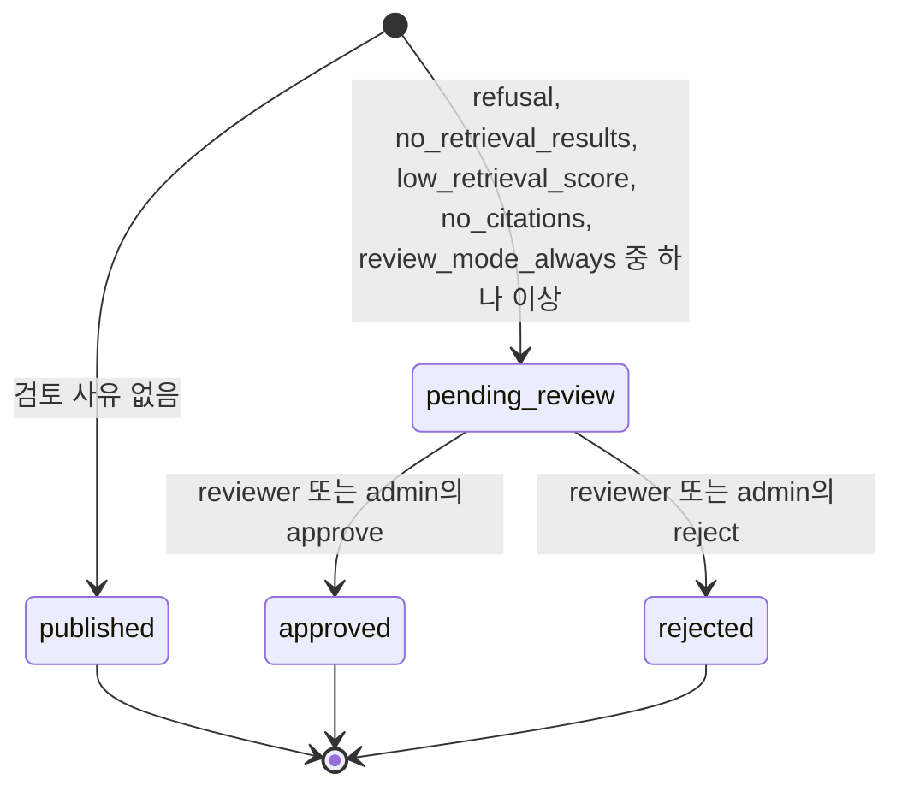

# 08. 사람 검토, 감사 로그, 사용량·비용

> 예상 소요: 45분 · 이전: [07. OpenDART 연동](07-dart-integration.md) · 다음: [09. 테스트와 운영](09-testing-and-ops.md)

## 이 문서에서 배울 것

- 답변 상태 네 가지와 상태가 바뀌는 조건, 역할별로 보이는 범위를 안다.
- 조건부 `UPDATE … WHERE status='pending_review'` 한 번으로 동시 검토 경쟁을 막는 원리를 설명할 수 있다.
- 감사 로그가 append-only로 보장되는 방법(DB 트리거)과, 업무 변경과 같은 트랜잭션에 기록하는 이유를 안다.
- 비용 계산식, 가격표가 없는 모델의 처리, `/usage`의 p50/p95가 무엇을 재는지 안다.

## 개념

- **[HITL](glossary.md#hitl)**(Human-in-the-loop): 자동화 결과 중 위험한 것을 사람이 확인하고 승인·거절하는 단계.
- **조건부 UPDATE**: "읽고 확인한 뒤 쓰기"를 두 번의 SQL로 나누지 않고, 확인 조건을 UPDATE의 WHERE에 넣어 한 문장으로 처리한다. DB가 행 단위로 원자성을 보장하므로 경쟁에서 한 요청만 이긴다. 낙관적 동시성 제어의 한 형태다.
- **[append-only](glossary.md#append-only)**: 추가만 되고 수정·삭제가 안 되는 기록. 감사 로그는 사후에 고칠 수 없어야 의미가 있다.
- **p50 / p95**: 지연시간을 정렬했을 때 50%, 95% 위치의 값. 평균은 느린 소수 요청을 숨기므로 꼬리 지연을 p95로 본다.

## 이 저장소의 구현

### 답변 상태와 신뢰도 규칙

출처: `src/footnote_rag/answering/service.py::review_reasons`

```python
    reasons: list[str] = []
    if llm_response is not None and llm_response.stop_reason == "refusal":
        reasons.append("refusal")
    if not retrieved:
        reasons.append("no_retrieval_results")
    elif max(c.score for c in retrieved) < settings.min_retrieval_score:
        reasons.append("low_retrieval_score")
    if footnote_count == 0 and "refusal" not in reasons:
        reasons.append("no_citations")
    if not reasons and settings.review_mode == "always":
        reasons.append("review_mode_always")
    return reasons
```

이유가 하나라도 있으면 `pending_review`이고 `answers.review_reason`에 쉼표로 이어 저장한다. `REVIEW_MODE=always`면 모든 답변이 검토로 간다. 테스트: `tests/test_answering.py::test_review_reason_rules`.

### 설계도: 답변 상태 전이



답변은 만들어지는 순간 `published` 또는 `pending_review` 중 하나로 시작한다. 검토 결정은 `pending_review`에서만 가능하며, 한 번 `approved`나 `rejected`가 되면 다시 바꾸는 API가 없다.
`published` 답변을 나중에 검토 대기로 돌리는 경로도 없다. 상태 값은 `answer_status` enum(`src/footnote_rag/db/models.py`의 `ANSWER_STATUSES`)으로 DB에서도 제한된다.

### 누가 무엇을 보나

| 역할 | `POST /questions` 응답 | `GET /answers/{id}` | `/reviews` |
| --- | --- | --- | --- |
| member | `pending_review`면 본문·각주 대신 "검토 대기 중" 안내 | `published`, `approved`만. 나머지는 404 | 403 |
| reviewer, admin | 전부 | 전부 | 조회·결정 가능 |

코드: `src/footnote_rag/answering/router.py::_visible_to`. member에게 `rejected` 답변이 404인 것도 이 규칙 때문이다. 테스트: `tests/test_answering.py::test_member_cannot_see_pending_answer`.

### 조건부 UPDATE로 동시 검토 막기

출처: `src/footnote_rag/reviews/router.py::decide`

```python
    result = await session.execute(
        update(Answer)
        .where(
            Answer.id == answer_id,
            Answer.org_id == org_id,
            Answer.status == "pending_review",
        )
        .values(
            status=new_status,
            reviewed_by=user_id,
            reviewed_at=func.now(),
            review_comment=body.comment,
        )
        .returning(Answer.id, Answer.reviewed_at, Answer.review_reason)
    )
    row = result.first()
    if row is None:
        await session.rollback()
        exists = await session.scalar(
            select(Answer.status).where(Answer.id == answer_id, Answer.org_id == org_id)
        )
        if exists is None:
            raise HTTPException(status_code=404, detail="Answer not found")
        raise HTTPException(status_code=409, detail=f"Answer is already {exists}")
```

- 두 검토자가 동시에 결정하면 Postgres는 같은 행의 UPDATE를 차례로 실행한다. 먼저 실행된 쪽이 상태를 바꾸고, 뒤의 UPDATE는 커밋된 새 상태를 보고 WHERE(`status='pending_review'`)에 맞지 않아 **0행**이 된다.
- 0행이면 행이 아예 없는지(다른 조직 포함 → 404), 이미 결정됐는지(409)를 구분해 응답한다.
- 감사 기록(`review.decided`)은 UPDATE가 성공했을 때만, **같은 트랜잭션**에서 추가된다. 진 요청은 감사 행을 남기지 않는다.
- "먼저 SELECT로 상태 확인 → 그다음 UPDATE"로 나누면 두 요청이 모두 `pending_review`를 보고 둘 다 덮어쓸 수 있다.
- 테스트: `tests/test_reviews_audit_usage.py::test_concurrent_reviews_one_wins_other_409`는 세 요청을 동시에 보내 상태 코드가 `[200, 409, 409]`이고 감사 행이 1개인지 확인한다.

### 감사 로그

**기록**: `src/footnote_rag/audit/service.py::record`는 세션에 `AuditLog` 행을 추가만 하고 커밋하지 않는다. 호출자가 업무 변경과 함께 커밋한다.

왜 같은 트랜잭션인가:
- 업무 변경은 커밋됐는데 감사 기록이 실패하면 "기록 없는 변경"이 생긴다. 반대로 감사만 남고 변경이 롤백되면 "일어나지 않은 일의 기록"이 생긴다. 한 트랜잭션이면 둘이 항상 함께 남거나 함께 사라진다.
- 예외: 실패 자체를 기록해야 하는 경로(LLM 오류, 로그인 실패)는 업무 변경을 롤백한 뒤 **감사만** 따로 커밋한다.

**action 목록**(`src/footnote_rag/audit/service.py::Actions`): `auth.login_succeeded`, `auth.login_failed`, `user.created`, `document.dart_import_requested`, `document.text_uploaded`, `document.ingest_succeeded`, `document.ingest_failed`, `document.ingest_retry_scheduled`, `question.asked`, `question.failed`, `answer.created`, `review.decided`.

**metadata 금지 키**: `password`, `password_hash`, `token`, `access_token`, `api_key`, `text`, `content`. 들어 있으면 `record`가 `ValueError`를 던진다. 질문·답변 본문은 감사 로그에 들어가지 않는다. 각 행에는 요청의 `request_id`가 함께 저장된다([09](09-testing-and-ops.md)).

**append-only 보장**: 출처 `alembic/versions/0001_initial.py::upgrade` (`op.execute`로 실행하는 SQL 문자열 세 개를 모아 옮김)

```sql
CREATE FUNCTION audit_logs_append_only() RETURNS trigger
LANGUAGE plpgsql AS $$
BEGIN
    RAISE EXCEPTION 'audit_logs is append-only (% rejected)', TG_OP
        USING ERRCODE = 'insufficient_privilege';
END;
$$;
CREATE TRIGGER audit_logs_no_update_delete BEFORE UPDATE OR DELETE ON audit_logs
    FOR EACH ROW EXECUTE FUNCTION audit_logs_append_only();
CREATE TRIGGER audit_logs_no_truncate BEFORE TRUNCATE ON audit_logs
    FOR EACH STATEMENT EXECUTE FUNCTION audit_logs_append_only();
```

애플리케이션 코드에 버그가 있거나 누군가 SQL을 직접 실행해도 UPDATE/DELETE/TRUNCATE는 거부된다. 테스트: `tests/test_reviews_audit_usage.py::test_audit_log_rejects_update_and_delete`. 조회는 admin 전용 `src/footnote_rag/audit/router.py::list_audit_logs`(action·기간 필터, `limit`/`offset`).

### 비용 계산과 사용량

출처: `src/footnote_rag/usage/pricing.py::compute_cost`

```python
    price = prices.get(model)
    if price is None:
        log.warning("usage.unpriced_model", model=model)
        return None
    total = (
        Decimal(usage.input_tokens) * price.input
        + Decimal(usage.output_tokens) * price.output
        + Decimal(usage.cache_read_input_tokens) * price.cache_read
        + Decimal(usage.cache_creation_input_tokens) * price.cache_write
    ) / _MILLION
    return total.quantize(Decimal("0.000001"))
```

- 가격표는 `src/footnote_rag/config.py`의 `DEFAULT_LLM_PRICES`(USD / 100만 토큰)다. 2026-11-24에 공식 가격 페이지를 보고 넣은 값이며, fallback 대상 모델도 들어 있다([ADR 0002](../adr/0002-claude-citations-search-result.md) "계획과 다른 점").
- 돈 계산이라 `float`가 아니라 `Decimal`을 쓴다. DB 컬럼도 `numeric(12, 6)`이다.
- 가격표에 없는 모델(예: Fake의 `fake-llm`)은 비용이 `NULL`이고 경고 로그를 남긴다. `/usage`의 `unpriced_calls`가 그런 호출 수다.
- 임베딩 비용은 계산하지 않는다. 임베딩 토큰 수만 작업 `result`와 `document.ingest_succeeded` 감사 metadata에 남는다([ADR 0003](../adr/0003-embedding-provider-voyage.md)).

`src/footnote_rag/usage/router.py::get_usage`는 조직의 `llm_calls`를 기간으로 걸러 호출 수, 토큰 합계, 비용 합계, 모델별 합계, 그리고 Postgres `percentile_cont(0.5)`, `percentile_cont(0.95)`로 **Claude 호출 지연시간**(`llm_calls.latency_ms`)의 p50/p95를 낸다. 임베딩·검색을 포함한 요청 전체 시간은 여기 들어가지 않는다. 테스트: `tests/test_reviews_audit_usage.py::test_usage_endpoint_aggregates_per_org`, `tests/test_reviews_audit_usage.py::test_cost_from_price_table`.

## 왜 이렇게 했나 / 대안 / 한계와 개선 방향

**왜**
- 근거가 약한 답을 막는 가드레일을 "모델에게 조심하라고 부탁하기"가 아니라 **관측 가능한 신호**(거절, 검색 0건, 낮은 점수, 인용 없음)로 정했다. 각 신호가 코드 한 줄로 설명된다.
- 동시 검토는 잠금(`SELECT … FOR UPDATE`)으로도 풀 수 있지만, 조건부 UPDATE 한 번이면 왕복이 적고 코드가 짧다.
- 감사 로그 보호를 애플리케이션이 아니라 DB 트리거에 둔 것은 코드 경로와 무관하게 적용되기 때문이다.

**대안**
- 검토 상태를 `version` 컬럼으로 관리하는 낙관적 잠금: 결정 외에 답변 편집 같은 여러 종류의 변경이 생기면 유용하다.
- 감사 로그를 별도 저장소(WORM 스토리지, 로그 수집 시스템)로 보내기: 운영자가 DB 권한으로 트리거를 지우는 위험까지 막으려면 필요하다.

**한계와 개선 방향**
- 검토자는 승인·거절만 할 수 있고 답변을 고칠 수 없다. 결정을 되돌리는 API도 없다.
- 트리거는 DB 소유자나 슈퍼유저가 `DROP TRIGGER`로 없앨 수 있다. 해시 체인 같은 변조 탐지는 없다.
- 감사 로그 보존 기간, 파티셔닝, 보관(archiving) 정책이 없다.
- `MIN_RETRIEVAL_SCORE` 같은 임계값을 실제 데이터로 보정하지 않았다([05](05-rag-retrieval.md)). 검토 대기 비율이 실제로 얼마나 될지 알 수 없다.
- fallback 시 시도별 사용량(`usage.iterations`)을 저장하지 않는다([06](06-claude-citations.md)).

## 확인 질문

1. 검색 결과는 있었지만 모델이 거절했다. `review_reason`은?
   <details><summary>답</summary>

   점수가 임계값 이상이면 `refusal` 하나다. 거절이면 `no_citations`는 붙이지 않는다(`"refusal" not in reasons` 조건). 점수도 낮았다면 `refusal,low_retrieval_score`.
   </details>

2. 두 검토자 중 진 쪽이 409 대신 200을 받는 버그가 생기려면 코드가 어떻게 바뀌어야 하나?
   <details><summary>답</summary>

   UPDATE의 WHERE에서 `Answer.status == "pending_review"`를 빼거나, 먼저 SELECT로 상태를 읽고 별도 UPDATE를 하도록 나누면 된다. 그러면 둘 다 1행을 바꾸고 뒤 요청이 앞 결정을 덮어쓴다. 감사 행도 2개가 된다.
   </details>

3. 질문 처리 중 Claude가 503을 냈다. DB에는 무엇이 남나?
   <details><summary>답</summary>

   `questions`, `answers`, `llm_calls`는 롤백되어 남지 않고, `question.failed` 감사 행만 커밋된다(metadata에 `status_code`, `reason`). 응답은 503.
   </details>

4. `/usage`의 `latency_ms_p95` 값이 X라면 무엇을 뜻하나?
   <details><summary>답</summary>

   그 기간 Claude 호출의 95%가 X ms 이하로 끝났다는 뜻이다. 임베딩·검색·DB 저장 시간은 포함하지 않는다. 이 저장소에는 실제 키로 쌓인 `llm_calls`가 없어서 실제 값은 아직 모른다.
   </details>
