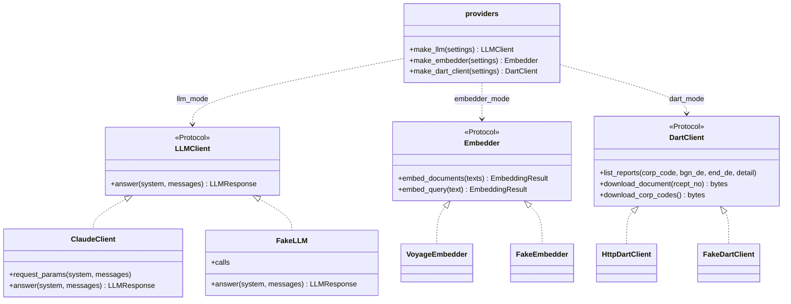
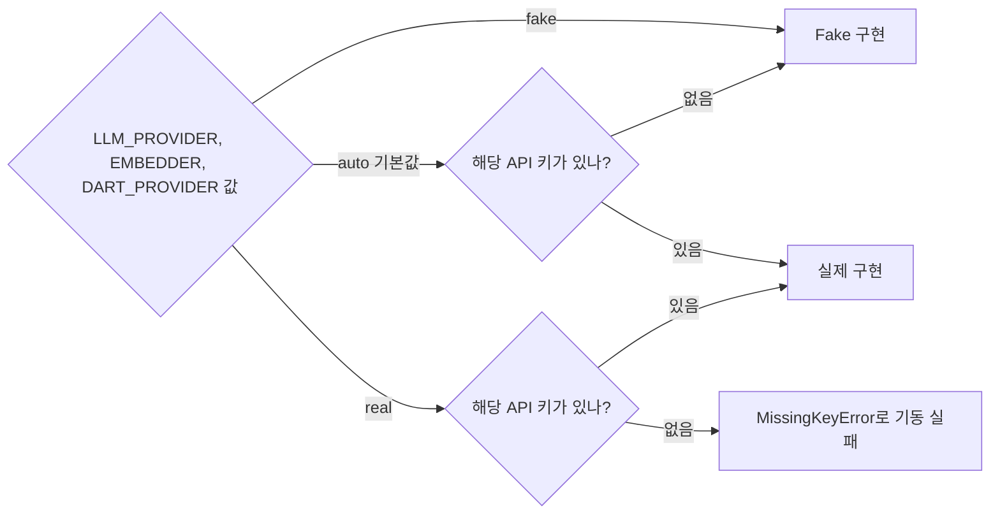

# 09. 테스트 구조와 운영: Fake 주입, 실제 Postgres, 비밀값, Docker, CI, 관측성

> 예상 소요: 45분 · 이전: [08. 검토·감사·사용량](08-review-audit-usage.md) · 다음: [10. Eval과 MCP](10-eval-and-mcp.md)

## 이 문서에서 배울 것

- Protocol + Fake 구조로 외부 API 없이 전체 흐름을 테스트하는 방법과, 실제/Fake를 고르는 규칙을 안다.
- 테스트가 SQLite가 아닌 **실제 Postgres(pgvector)** 를 쓰는 이유와 동시성 테스트 기법을 설명할 수 있다.
- 비밀값이 코드·로그·이미지·저장소로 새지 않게 하는 장치를 나열할 수 있다.
- Docker Compose 서비스 구성, CI 단계, request_id 기반 관측성을 설명할 수 있다.

## 개념

- **Protocol**(`typing.Protocol`): "이 메서드들을 가진 객체면 된다"는 구조적 인터페이스. 상속 없이도 같은 모양이면 대체할 수 있다.
- **Fake**: 실제 구현과 같은 인터페이스를 가진, 네트워크 없는 결정적 구현. 호출 기록을 남겨 테스트에서 검사할 수 있다. Mock(호출 기대치를 미리 설정)과 달리 동작을 실제로 흉내 낸다.
- **의존성 주입**: 객체가 쓸 의존성을 스스로 만들지 않고 밖에서 받는 것. 여기서는 `app.state`와 `JobContext`가 주입 지점이다.
- **SecretStr**(pydantic): 값을 감싸 `repr`이나 직렬화에서 `**********`로 보이게 하는 타입. 값을 쓰려면 `get_secret_value()`를 명시적으로 불러야 한다.

## 이 저장소의 구현

### 실제/Fake 제공자 선택

출처: `src/footnote_rag/config.py::Settings._resolve`, `src/footnote_rag/providers.py::make_llm`

```python
    def _resolve(self, choice: ProviderChoice, key: SecretStr | None) -> Literal["fake", "real"]:
        if choice == "auto":
            return "real" if key is not None and key.get_secret_value() else "fake"
        return choice
```

```python
def make_llm(settings: Settings | None = None) -> LLMClient:
    from footnote_rag.answering.llm import ClaudeClient, FakeLLM

    s = settings or get_settings()
    if s.llm_mode == "fake":
        return FakeLLM()
    return ClaudeClient(
        api_key=_require(s.anthropic_api_key, "ANTHROPIC_API_KEY"),
        ...
    )
```

### 설계도: 실제/Fake 제공자 선택 구조



외부 의존성 셋은 각각 Protocol 하나와 구현 둘(실제, Fake)을 가진다. `providers.py`의 팩토리 함수가 설정의 `*_mode` 값을 보고 둘 중 하나를 만든다.
API는 `main.lifespan`에서 만든 LLM·임베더를 `app.state`에 두고, 워커는 `JobContext`에 담아 핸들러에 넘긴다. 테스트는 이 두 자리에 Fake를 직접 넣는다.



`auto`는 키가 있으면 실제, 없으면 Fake를 고른다. 그래서 키 없이 `docker compose up`만 해도 전체 스택이 돈다.
`real`을 명시했는데 키가 없으면 조용히 Fake로 바꾸지 않고 오류를 낸다(`src/footnote_rag/providers.py::_require`). 그래서 실제 모드로 띄웠다고 믿었는데 합성 데이터가 쓰이는 상황은 생기지 않는다. `.env`의 `KEY=`처럼 빈 값은 미설정으로 본다(`env_ignore_empty=True`).

### 테스트가 Fake를 강제하는 방법

`tests/conftest.py`는 **애플리케이션 모듈을 import하기 전에** 환경변수를 고친다.
- `ANTHROPIC_API_KEY`, `VOYAGE_API_KEY`, `OPENDART_API_KEY`를 프로세스 환경에서 지운다.
- `FOOTNOTE_DISABLE_DOTENV=1`로 `.env`를 아예 읽지 않는다(`src/footnote_rag/config.py::load_settings`).
- `LLM_PROVIDER`, `EMBEDDER`, `DART_PROVIDER`를 `fake`로 고정한다.
- 세션 픽스처 `_database`가 세 모드가 모두 fake인지 assert한다.

그래서 테스트는 Claude·Voyage·OpenDART에 네트워크 요청을 보내지 않는다. 실제 SDK 경로는 **스텁**으로 검증한다.
- Claude: `ClaudeClient(client=...)`에 가짜 SDK 객체를 넣어 요청 인자를 검사한다(`tests/test_answering.py::test_claude_request_shape`).
- Voyage: `monkeypatch`로 SDK 클라이언트를 바꿔 `input_type`과 배치를 확인한다(`tests/test_answering.py::test_voyage_embedder_uses_input_types_and_batches`).
- OpenDART·MCP: `httpx.MockTransport`로 HTTP 응답을 꾸민다(`tests/test_dart_client.py::test_http_and_network_failures_are_classified`, `tests/test_evals_cli_mcp.py::test_mcp_tools_call_http_api_with_token`).

### 실제 Postgres로 테스트하는 이유

- `FOR UPDATE SKIP LOCKED`, `UNIQUE` 제약 위반, 조건부 UPDATE 경쟁, 감사 로그 트리거, pgvector 연산자와 HNSW, `percentile_cont`는 모두 Postgres 고유 동작이다. SQLite나 메모리 대체물로는 검증할 수 없다.
- 스키마는 테스트 세션마다 `public` 스키마를 지우고 **실제 Alembic 마이그레이션**으로 다시 만든다(`tests/conftest.py`의 `_database`). 마이그레이션 자체도 함께 검증된다.
- `jobs`는 조직 범위가 없으므로 테스트마다 비운다(`_clean_jobs`). 다른 테이블은 테스트마다 새 조직을 만들어(`make_org`) 서로 간섭하지 않게 한다.

### 동시성 테스트 기법

- `asyncio.gather`로 여러 코루틴을 동시에 실행하되 **각자 다른 세션**을 쓴다. 다른 커넥션이어야 실제 잠금 경쟁이 생긴다.
- 예: `tests/test_jobs.py::test_concurrent_claims_get_one_job_once`(claim 5개 → 1개만 성공), `tests/test_documents.py::test_concurrent_duplicate_imports_create_one_document`, `tests/test_reviews_audit_usage.py::test_concurrent_reviews_one_wins_other_409`.
- 결과는 "정확히 몇 개가 성공했나"와 "부수 효과(감사 행, 문서 수)가 몇 개인가"를 함께 본다.

### 비밀값 보호

| 장치 | 위치 |
| --- | --- |
| API 키와 JWT 비밀을 `SecretStr`로 보관 | `src/footnote_rag/config.py::Settings` |
| 운영 모드에서 기본 JWT 비밀이면 기동 거부 | `src/footnote_rag/main.py::lifespan` |
| 로그에서 비밀번호·토큰·키 필드와 `crtfc_key` 값 마스킹 | `src/footnote_rag/observability.py::configure_logging` |
| 감사 metadata에 비밀번호·토큰·본문 금지 | `src/footnote_rag/audit/service.py::record` |
| `.env`, `.env.*`(단 `.env.example` 제외), `data/`를 git과 Docker 빌드에서 제외 | `.gitignore`, `.dockerignore` |
| 키는 런타임 `env_file`로만 주입, 이미지에 없음 | `docker-compose.yml`, `Dockerfile` |
| 테스트·CI는 `.env`를 읽지 않음 | `tests/conftest.py`, `.github/workflows/ci.yml` |

테스트: `tests/test_config.py::test_secrets_are_masked_in_repr_and_dump`, `tests/test_config.py::test_settings_in_log_output_are_masked`, `tests/test_config.py::test_structlog_processor_masks_sensitive_fields`.

### Docker Compose 구성

| 서비스 | 하는 일 | 특징 |
| --- | --- | --- |
| `db` | `pgvector/pgvector:pg16` | `127.0.0.1:5433`에만 공개, healthcheck `pg_isready` |
| `migrate` | `alembic upgrade head` 한 번 실행 | `db`가 healthy가 된 뒤 |
| `api` | uvicorn | `migrate`가 성공한 뒤 기동, healthcheck는 `/readyz` |
| `worker` | `python -m footnote_rag.jobs.worker` | `stop_signal: SIGTERM`, `stop_grace_period: 60s` |

`Dockerfile`은 2단계 빌드다. builder 단계에서 `uv sync --frozen --no-dev`로 의존성을 설치하고, runtime 단계는 slim 이미지에 비루트 사용자(uid 10001)로 실행한다. 비밀값은 이미지에 넣지 않는다.

### CI

`.github/workflows/ci.yml`은 `pgvector/pgvector:pg16` 서비스 컨테이너를 띄우고 비밀값 없이(`FOOTNOTE_DISABLE_DOTENV=1`, 세 제공자 `fake`) 다음을 순서대로 실행한다.
1. `uv sync --frozen`
2. `uv run ruff check .`
3. `uv run ruff format --check .`
4. `uv run alembic upgrade head`
5. `uv run pytest -q`

Eval(`evals.run`)은 CI에서 돌리지 않는다.

### 관측성: structlog와 request_id

- `src/footnote_rag/main.py::create_app`의 미들웨어가 `X-Request-ID` 헤더를 받는다. 형식(`^[A-Za-z0-9._-]{1,100}$`)이 맞지 않거나 없으면 새로 만든다. 값을 `request_id_var`(ContextVar)에 넣고 응답 헤더에도 돌려준다.
- 모든 structlog 이벤트에 `request_id`가 붙고(`_add_request_id`), 요청마다 `http.request` 로그에 메서드·경로·상태·`duration_ms`가 남는다.
- 감사 로그 행에도 같은 `request_id`가 저장되므로, 감사 기록 하나에서 그 요청의 애플리케이션 로그를 찾아갈 수 있다.
- `/healthz`는 프로세스 생존, `/readyz`는 DB `SELECT 1`까지 확인한다(실패 시 503).
- 처리되지 않은 예외는 미들웨어가 잡아 로그를 남기고 500 JSON을 돌려준다.

## 왜 이렇게 했나 / 대안 / 한계와 개선 방향

**왜**
- 키 없이도 누구나 저장소를 받아 전체 흐름을 돌려 볼 수 있어야 한다. 그리고 테스트·CI가 외부 서비스 상태나 비용에 흔들리지 않아야 한다.
- 이 서비스의 핵심 정확성(중복 처리 방지, 동시 검토, 격리, 감사 불변성)은 DB 동작에 달려 있어 실제 DB로 테스트해야 의미가 있다.

**대안**
- `unittest.mock`으로 SDK를 모두 mock: 빠르지만 "mock이 기대한 대로 불렸다"만 확인하고 전체 흐름(검색 → 각주 → 저장)을 검증하기 어렵다.
- Testcontainers로 테스트가 DB 컨테이너를 직접 띄우기: 지금은 README 안내대로 미리 띄운 DB(`127.0.0.1:55439`)를 쓴다.
- VCR류(실제 응답 녹화·재생): 실제 응답 모양을 고정할 수 있지만 녹화에 키가 필요하고 응답에 비밀이 섞이지 않게 관리해야 한다.

**한계와 개선 방향**
- 메트릭(Prometheus 등)과 분산 트레이싱(OpenTelemetry)이 **없다.** 지표는 로그와 `/usage`로만 본다.
- Kubernetes 매니페스트, 오토스케일링 설정이 **없다.** 배포 대상은 Docker Compose까지다.
- 부하 테스트를 하지 않았다. 처리량·지연시간 수치가 없다.
- Fake 구현은 형식과 흐름만 검증한다. FakeEmbedder 점수 분포와 FakeLLM 응답은 실제 모델과 다르므로 품질 판단에 쓰면 안 된다.
- 실제 제공자 경로(실제 키로 Claude·Voyage·OpenDART 호출)를 자동으로 검증하는 테스트는 없다.

## 확인 질문

1. 개발자가 `.env`에 `ANTHROPIC_API_KEY=`(빈 값)만 적었다. `LLM_PROVIDER=auto`면 어떤 구현이 쓰이나? `LLM_PROVIDER=real`이면?
   <details><summary>답</summary>

   빈 값은 미설정으로 본다(`env_ignore_empty=True`). `auto`면 `FakeLLM`, `real`이면 `MissingKeyError`로 앱이 기동하지 못한다.
   </details>

2. 테스트 중 실수로 실제 Claude API를 호출할 가능성을 막는 장치는?
   <details><summary>답</summary>

   `tests/conftest.py`가 import 전에 키 환경변수를 지우고, `.env`를 읽지 않게 하고, 제공자를 `fake`로 고정한다. 세션 픽스처가 모드를 assert하고, `app` 픽스처가 `app.state.llm`에 `FakeLLM`을 넣는다.
   </details>

3. 동시 claim 테스트를 SQLite로 옮기면 안 되는 이유는?
   <details><summary>답</summary>

   SQLite는 `FOR UPDATE SKIP LOCKED`를 지원하지 않고 잠금 모델도 다르다. 검증하려는 동작 자체가 없으므로 테스트가 의미를 잃는다.
   </details>

4. 감사 로그에서 이상한 `review.decided` 행을 발견했다. 그 요청의 애플리케이션 로그를 어떻게 찾나?
   <details><summary>답</summary>

   감사 행의 `request_id`로 JSON 로그를 검색한다. 같은 요청의 `http.request` 로그와 그 요청 중 남은 모든 structlog 이벤트에 같은 `request_id`가 붙어 있다.
   </details>
