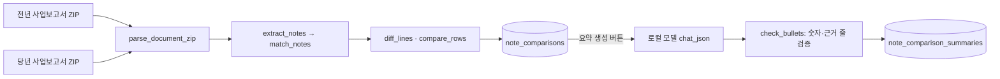

# 11. 전기 대비 주석 변동 분석

## 이 문서에서 배울 것

- 같은 회사의 작년·올해 사업보고서 주석을 **코드가** 짝짓고 비교하는 방법
- 표를 ` | `로 이은 줄에서 기간(당기·전기)과 행·값을 뽑는 규칙과 그 한계
- 로컬 모델에게 **요약만** 맡기고, 요약의 숫자와 근거 줄을 다시 코드로 검증하는 흐름

## 개념

**전기 대비 변동 검토**는 감사인이 매년 하는 일입니다. 올해 주석을 작년 주석과 대조해 새 약정·소송, 사라진 문장, 크게 바뀐 금액을 찾습니다. 올해 보고서의 "전기" 칸은 작년 보고서의 "당기" 칸과 같아야 합니다. 다르면 재작성·재분류의 **후보**입니다(판단은 사람이 합니다).

비교는 결정적이어야 합니다. 같은 두 보고서를 넣으면 늘 같은 결과가 나와야 하고, 숫자 계산이 틀리면 안 됩니다. 그래서 탐지와 계산은 코드가 하고, 모델은 사람이 읽기 쉬운 요약만 만듭니다([ADR 0012](../adr/0012-note-change-analysis.md)).

## 이 저장소의 구현

1. **주석 뽑기와 짝짓기**: `src/footnote_rag/comparison/notes.py::extract_notes`가 `statement_scope`(연결/별도)로 섹션을 고르고 `note_key`로 묶습니다. `src/footnote_rag/comparison/notes.py::match_notes`는 키가 같으면 짝, 남은 것은 제목 유사도 0.85 이상을 일대일로 짝짓고, 그래도 남으면 `added`/`removed`입니다.
2. **줄 비교**: `src/footnote_rag/comparison/notes.py::diff_lines`가 `difflib.SequenceMatcher`로 줄을 비교합니다. 숫자를 `#`로 가린 뒤 같아지는 줄 쌍은 `numbers_only`입니다(`src/footnote_rag/comparison/notes.py::mask_numbers`).
3. **표 해석**: `src/footnote_rag/comparison/notes.py::parse_table_rows`가 `당기 | (단위 : 백만원)` 같은 기간 블록과 `구분 | 당기말 | 전기말` 열 머리글을 읽어 행마다 (표 제목, 행 이름, 순번, 기간, 값)을 만듭니다. 숫자 셀은 `src/footnote_rag/comparison/notes.py::parse_number`가 해석합니다(`(1,234)`·`△1,234` 음수, `-` 0, 날짜·연도 제외).
4. **숫자 비교**: `src/footnote_rag/comparison/notes.py::compare_rows`가 `yoy`(증감·증감률), `prior_mismatch`, `row_added`/`row_removed`를 만들고, 순번으로 짝지을 수 없는 중복 행은 `ambiguous_rows`로 셉니다. 큰 변동 판정은 `src/footnote_rag/comparison/notes.py::is_large_change`입니다.
5. **우선순위**: `src/footnote_rag/comparison/notes.py::note_score`가 관심 주석(`NOTE_DIFF_WATCHLIST`)을 맨 앞에 두는 점수를 매기고, `src/footnote_rag/comparison/notes.py::compare_documents`가 점수순으로 정렬합니다.
6. **저장과 API**: `src/footnote_rag/comparison/service.py::create_comparison`이 두 문서를 검사하고(다른 조직 404, 그 밖 422) 원문 ZIP 캐시를 파싱해 결과를 `note_comparisons`에 저장합니다. 라우터는 `src/footnote_rag/comparison/router.py`입니다.
7. **요약(요청할 때만)**: `src/footnote_rag/comparison/service.py::summarize_note`가 `src/footnote_rag/comparison/prompt.py::build_summary_prompt`로 바뀐 줄과 숫자 변동 표만 담은 프롬프트를 만들고 `src/footnote_rag/answering/local_llm.py::OllamaClient.chat_json`을 부릅니다. `src/footnote_rag/comparison/prompt.py::check_bullets`가 요약 숫자를 자료에서 찾고(점 천 단위 표기 인정), 자료에 없는 근거 줄 번호를 버립니다.
8. **Eval**: `src/footnote_rag/evals/note_diff.py::run_note_diff`가 정답 탐지율과 쌍별 통계를 리포트로 쓰고, `src/footnote_rag/evals/validate_note_changes.py::validate_note_changes`가 정답 인용문이 실제 주석에 있는지 검사합니다.

## 왜 이렇게 했나

- **모델에게 비교를 맡기지 않는다**: 긴 주석 두 개를 통째로 주면 컨텍스트를 넘고, 모델이 차이를 계산하다 틀리며, 무엇을 놓쳤는지 알 수 없습니다. 코드 비교는 놓친 것도 재현할 수 있습니다.
- **숫자만 바뀐 줄을 따로 둔다**: 표가 많은 주석은 매년 거의 모든 금액 줄이 바뀝니다. 이것을 문장 변경과 섞으면 진짜 새 문장(새 약정, 새 소송)이 묻힙니다.
- **전기 수치 불일치는 후보로만 보여 준다**: 행 이름 중복이나 표 구성 변경으로도 생기므로 자동 판정하지 않습니다.
- **Claude는 지원하지 않는다**: 주석마다 반복해 누를 수 있는 기능이라 API 비용이 쌓입니다. 계산이 없는 요약이라 로컬 모델로 충분합니다.

한계: 계층형 열 이름은 복원하지 않고 위치로만 비교하며, 단위(백만원/천원)를 환산하지 않습니다. 요약 검증은 숫자와 근거 줄만 보므로 숫자 없는 잘못된 서술은 잡지 못합니다.

## 확인 질문

1. 올해 보고서의 "전기 장기차입금 11,500"과 작년 보고서의 "당기 장기차입금 11,000"이 다르면 어떤 결과가 나오나요?

답

`prior_mismatch`(전기 수치 불일치) 한 건이 생깁니다. 재작성·재분류 후보로 표시만 하고 판단은 담당자가 합니다. 큰 변동 표시는 전년 대비(`yoy`)에만 붙습니다.

2. 같은 표에 "합계" 행이 작년에는 2번, 올해는 3번 나오면 왜 비교하지 않나요?

답

행 식별자는 (표 제목, 행 이름, 순번)인데, 개수가 다르면 올해의 몇 번째 "합계"가 작년의 몇 번째와 짝인지 위치로 알 수 없습니다. 틀린 짝으로 잘못된 증감을 보여 주는 대신 `ambiguous_rows`로 세고 줄 비교에서 확인하게 합니다.

3. 모델이 요약에 "약 1.2조 원"이라고 쓰면 어떻게 되나요?

답

`1.2`가 프롬프트 자료에 없으므로 그 항목은 근거 없음이 되고 요약 상태가 `needs_review`, `ungrounded_numbers`에 `1.2`가 남습니다. 단위 환산은 일부러 인정하지 않습니다. 화면에는 "확인 필요: 원문에 없는 숫자 1.2"가 보입니다.

