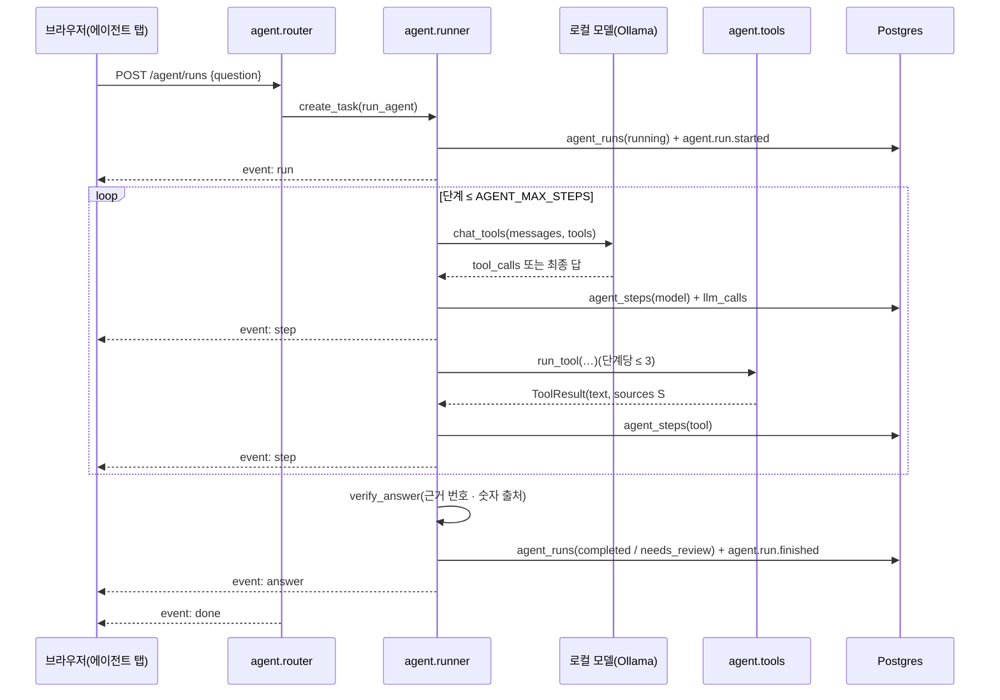

# 12. 도구를 쓰는 에이전트

> 예상 소요: 40분 · 이전: [11. 전기 대비 주석 변동 분석](11-note-change-analysis.md) · 설계 기록: [ADR 0013](../adr/0013-tool-using-agent.md)

## 이 문서에서 배울 것

- "모델은 도구를 고르고, 코드가 실행·제한·기록·검증한다"는 에이전트 루프의 구조
- 계산을 모델에서 빼내는 방법: **앞선 도구 결과에 실제로 나온 숫자만** 받는 계산 도구
- 최종 답을 코드로 검증하는 규칙(근거 번호, 숫자 출처)과 그 한계
- 진행을 SSE로 흘려보내고, 끊기면 실행을 멈추는 방법

## 개념

**도구 호출(tool calling)** 은 모델에게 "쓸 수 있는 함수 목록(이름, 설명, JSON Schema 인자)"을 주고, 모델이 답 대신 "이 함수를 이 인자로 불러 달라"고 응답하게 하는 방식입니다. 프로그램이 함수를 실행해 결과를 다시 대화에 넣으면 모델은 다음 함수를 고르거나 최종 답을 냅니다. 이것을 반복하는 것이 **에이전트 루프**입니다.

로컬 모델에 여러 단계 작업을 맡기면 세 가지가 위험합니다. (1) 금액을 직접 나누거나 단위를 바꾸다 틀린다. (2) 없는 근거를 인용하거나 같은 일을 반복한다. (3) 그 숫자가 어디서 왔는지 사람이 따라갈 수 없다. 이 저장소는 셋 다 **코드의 안전장치**로 막습니다. 계산은 계산 도구만, 반복과 길이는 상한으로, 근거는 실행 전체에서 유일한 번호(`S#`, `N#`, `C#`, `F#`, `K#`)와 단계 기록으로.

## 이 저장소의 구현

1. **도구 6개**: `src/footnote_rag/agent/tools.py::Tool`이 이름·한국어 라벨·설명·JSON Schema·실행 함수를 묶고 `TOOLS`에 등록합니다. `src/footnote_rag/agent/tools.py::list_documents`, `src/footnote_rag/agent/tools.py::search_filings`(기존 `src/footnote_rag/answering/service.py::retrieve`), `src/footnote_rag/agent/tools.py::read_note`(주석 찾기는 `src/footnote_rag/agent/tools.py::find_note`: 번호 → 키 일치 → 유사도 0.6 이상 → 후보 10개 오류), `src/footnote_rag/agent/tools.py::compare_notes`(#11의 `src/footnote_rag/comparison/notes.py::compare_documents`), `src/footnote_rag/agent/tools.py::get_financials`, `src/footnote_rag/agent/tools.py::calculate`입니다. 모두 읽기 전용입니다.
2. **실행 한 번의 상태**: `src/footnote_rag/agent/tools.py::build_context`가 `src/footnote_rag/agent/tools.py::AgentContext`를 만듭니다. 문서 별칭(`src/footnote_rag/agent/tools.py::load_aliases`: 그 조직의 ready DART 문서만, 회사명 → 최신순), 보고 기간(`src/footnote_rag/agent/tools.py::load_periods`: 표지 청크의 "2025년 01월 01일부터 2025년 12월 31일까지", `src/footnote_rag/agent/tools.py::cover_period`), 파싱 캐시, 근거와 숫자가 여기 모입니다. 모델은 UUID를 보지도 쓰지도 못합니다.
3. **도구 실행 규칙**: `src/footnote_rag/agent/tools.py::run_tool`은 예외를 던지지 않습니다. 없는 도구, 스키마에 맞지 않는 인자(`src/footnote_rag/agent/tools.py::validate_args`), 도구 실패는 모두 `ok=False`와 "오류: …" 한국어 문장으로 모델에게 돌아가 다음 단계에서 고칠 수 있습니다. 결과는 `AGENT_TOOL_RESULT_CHARS`에서 자르고, 잘린 부분의 근거는 버립니다(모델이 못 봤으므로).
4. **계산기**: `src/footnote_rag/agent/tools.py::evaluate_expression`이 `ast`로 `+ - * /`, 괄호, `round(x, n)`(half-up), 이름만 허용하고 `Decimal`로 계산합니다. `src/footnote_rag/agent/tools.py::resolve_value`가 각 값을 앞선 결과의 숫자에서 찾습니다(`src/footnote_rag/answering/number_check.py::contains_number`, 쉼표·점 천 단위 인정). 못 찾으면 "출처 없는 값". 수식에 쓴 숫자는 한 자리 정수와 10^1~10^12만 됩니다.
5. **재무제표 API**: `src/footnote_rag/dart/client.py::HttpDartClient.financial_statements`가 OpenDART `fnlttSinglAcntAll.json`을 부르고 `data/dart/fnltt/`에 캐시합니다(`013`은 빈 목록). 보고서 코드는 `src/footnote_rag/agent/tools.py::report_code`(사업 11011, 반기 11012, 1분기 11013, 3분기 11014). Fake는 `src/footnote_rag/dart/fake_data.py::financial_statement_rows`입니다.
6. **루프**: `src/footnote_rag/agent/runner.py::run_agent` → `src/footnote_rag/agent/runner.py::_Run.loop`. 모델 호출은 `src/footnote_rag/answering/local_llm.py::OllamaClient.chat_tools`(`/api/chat`에 `tools`, `format` 없음). 단계당 도구 3개까지, 단계 6개에서 또는 같은 호출 3번 연속이면 도구 없이 한 번 더 부르고 `step_limit`/`repeated_call`을 남깁니다. 테스트·Fake 모드는 `src/footnote_rag/answering/llm.py::FakeLLM.chat_tools`(스크립트 재생)입니다.
7. **최종 답 검증**: `src/footnote_rag/agent/runner.py::verify_answer`가 없는 근거 번호를 지우고(개수 기록), 답의 숫자가 도구 결과에 있는지 보고, `no_citations`·`ungrounded_number`·`tool_errors` 사유를 붙입니다. 사유가 있으면 `needs_review`, 없으면 `completed`.
8. **기록**: 단계마다 `agent_steps`에 즉시 커밋하고(모델에 보낸 결과 그대로), 모델 호출마다 `llm_calls`(`agent_run_id`, 비용 0), 시작·끝에 감사 로그 `agent.run.started`/`agent.run.finished`를 남깁니다.
9. **API와 화면**: `src/footnote_rag/agent/router.py::post_run`이 실행을 백그라운드 태스크로 돌리고 큐의 이벤트를 SSE로 보냅니다. 스트림이 닫히면 태스크를 취소하고, 실행은 스스로 `failed`(`client_disconnected`)로 마칩니다. 빈 질문(422)과 `LLM_PROVIDER=real`(501, `src/footnote_rag/agent/runner.py::supports_agent`)은 스트림을 열기 전에 답합니다. 다시 보기는 `src/footnote_rag/agent/router.py::get_run`입니다. 화면(`src/footnote_rag/web/static/app.js`의 `runAgent`, `readAgentStream`, `parseSseBlock`, `showAgentSource`)은 `fetch` + `ReadableStream`으로 읽고 `AbortController`로 중지합니다.
10. **Eval**: `src/footnote_rag/evals/agent.py::run_agent_eval`이 과제를 모델별로 돌리고 `src/footnote_rag/evals/agent.py::score_task`로 채점합니다.

## 왜 이렇게 했나

- **계산을 도구로 뺀다**: 기존 질문 흐름은 "모델이 계산한 숫자"를 잡아 검토로 보낼 수만 있었습니다(#53). 계산 도구는 맞는 숫자를 만드는 길을 줍니다. 값을 앞선 결과에서만 받게 해, 모델이 어림한 값을 넣어 우회하는 것도 막습니다.
- **오류를 예외 대신 결과로 돌려준다**: 작은 모델은 인자 이름을 틀리거나 없는 계정을 찾습니다. 실패를 "오류: 일치하는 계정이 없습니다. 계정명 목록: …"으로 돌려주면 다음 단계에서 스스로 고칩니다. 오류가 절반을 넘으면 `tool_errors`로 검토에 보냅니다.
- **상한 뒤에 도구 없는 한 번**: 그냥 끊으면 아무 답도 없습니다. 도구 없이 "모은 근거로만 답하라"고 한 번 더 부르면 쓸 수 있는 답이 남고, 사유가 붙어 검토로 갑니다.
- **SSE**: 워커는 LLM을 부르지 않는다는 원칙을 지키면서, 단계가 생기는 즉시 보여 줄 수 있는 가장 단순한 방법입니다. 단계는 DB에도 즉시 저장되므로 스트림을 놓쳐도 다시 열 수 있습니다.
- **대안**: plan-and-execute(먼저 계획 → 실행)는 문서·계정 이름을 모르는 채로 세운 계획이 첫 결과에서 어긋나기 쉽습니다. Claude tool use는 단계마다 입력이 쌓여 비용이 커서 이번 범위 밖입니다(같은 도구·검증 코드에 클라이언트만 바꾸면 됨).

한계: 계산은 정확하지만 **어떤 값을 넣을지는 모델이 고릅니다**(부채총계 대신 유동부채를 넣어도 숫자 검증은 통과). 숫자 검증은 "어딘가의 도구 결과에 있나"만 보므로 엉뚱한 근거의 같은 숫자도 통과하고, 숫자 없는 잘못된 서술은 잡지 못합니다. 그래서 화면은 `K#`의 값 출처를 보여 주고 판단을 담당자에게 맡깁니다. 실측은 아직 없습니다(`evals/agent_tasks_live.jsonl`은 예시 행만).

## 화면 수동 확인 (Fake 모드)

1. `LLM_PROVIDER=fake`, `DART_PROVIDER=fake`로 띄우고 문서 탭에서 `20260310900101`과 `20250310900101`을 가져옵니다.
2. 에이전트 탭에서 아무 질문이나 실행하면 Fake 데모 정책(`list_documents` → `search_filings` → 첫 검색 결과를 인용한 답)이 돕니다. 단계가 하나씩 쌓이고 스피너·경과 시간이 보이는지, 답의 `[S1]`을 누르면 오른쪽에 목차 경로와 본문 발췌가 나오는지 봅니다.
3. 재무제표·계산 경로는 `python -m footnote_rag.evals.agent`(Fake)의 리포트에서 단계 기록으로 확인합니다.

## 확인 질문

1. 모델이 `calculate("38765 / 60000 * 100", {})`를 부르면 어떻게 되나요?

답

수식의 `38765`와 `60000`은 한 자리 정수도 단위 상수(10, 100, …)도 아니라서 "수식에 직접 쓴 숫자 … 허용되지 않습니다" 오류가 모델에게 돌아갑니다. 값은 `values`로 넘겨야 하고, 그 값도 앞선 도구 결과(예: `F1`의 `38,765,000,000`)에 있어야 합니다.

2. 최종 답이 "부채비율은 약 64.61%입니다 [F1][F2]."이면 상태와 사유는 무엇인가요?

답

`[F1]`, `[F2]`는 실제 근거라 남지만, `64.61`은 어떤 도구 결과에도 없습니다(계산 도구를 쓰지 않음). 사유 `ungrounded_number`, 상태 `needs_review`("확인 필요: 도구 결과에 없는 숫자")입니다. Eval은 이 과제를 "모델이 직접 계산하려 한 과제"로 셉니다.

3. 같은 `read_note(D1, 차입금)`를 세 번 연속 부르면 무슨 일이 일어나나요?

답

세 번째 호출은 실행하지 않고 루프를 멈춥니다. 대화에 "도구를 더 부를 수 없다, 지금까지 모은 근거로만 답하라"를 덧붙여 도구 목록 없이 한 번 더 부르고, 그 답을 최종 답으로 검증합니다. 사유 `repeated_call`이 붙어 상태는 `needs_review`입니다.

4. 사용자가 화면에서 "중지"를 누르면 서버의 실행은 어떻게 되나요?

답

브라우저가 `AbortController`로 요청을 끊으면 SSE 스트림 생성기가 닫히고, 라우터가 백그라운드 태스크를 취소합니다. 실행은 `CancelledError`를 받아 `failed`, `error = "client_disconnected"`로 `agent_runs`를 마무리하고 감사 로그 `agent.run.finished`를 남깁니다. 그때까지의 단계는 이미 `agent_steps`에 저장돼 있습니다.

